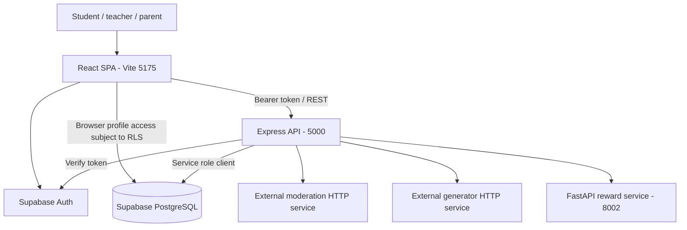
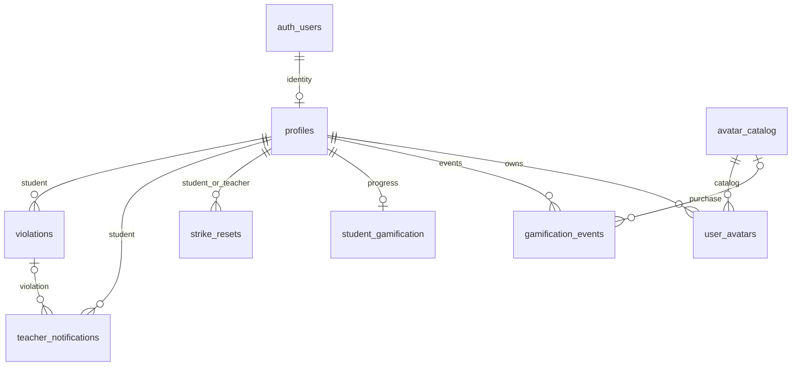

# System Architecture

Last inspected: 2026-09-28. Status: source-based baseline; deployed behavior has not been verified.

## 1. Document Purpose

Describe the current EduBuz codebase for developers and AI coding agents. Source files take precedence over this document. Update this file when entry points, services, contracts, authentication, or migrations change. Related documents: [project memory](02-PROJECT-MEMORY.md), [product requirements](03-PRD-ACADEMIC-PRODUCTIVITY.md), [development rules](04-DEVELOPMENT-RULES.md), [design system](05-DESIGN-SYSTEM.md), and [tasks](06-PROJECT-TASKS.md).

Evidence means checked-in/local source, not proof that a migration has run or a service is reachable. Unconfirmed deployment details are **Unknown / Needs Verification**.

## 2. System Overview

EduBuz provides educational chat with input/output moderation, student strikes, teacher notifications and resets, XP rewards, spendable EXP, and cosmetic avatar collections. The UI also includes a parent dashboard. Names such as EduBot and Bingo remain in code and assets.

- Frontend: React SPA served by Vite, using React Router, Tailwind, Axios, and Supabase Auth.
- AI integrations: HTTP moderation and generator clients; their model server implementations are not included. The client integrates external moderation and Qwen generation endpoints; example local model-service ports are 8000/8001. Actual models, training, hosting, and uptime are **Unknown / Needs Verification**.
- Reward service: local stateless Python FastAPI application; Express persists reward results to Supabase.
- Runtime: separate Node frontend/backend processes and Python reward process. Vite uses port 5175; Express defaults to 5000; reward defaults to 8002. Exact installed Node/Python versions and production deployment are **Unknown / Needs Verification**.

## 3. High-Level Architecture



The reward service calculates results without a database connection. Dataset spreadsheets are research assets, not runtime services.

## 4. Technology Stack

Versions below are manifest declarations, not verified installed versions.

| Layer | Technology | Declared version | Purpose | Evidence |
| --- | --- | --- | --- | --- |
| Frontend | React / React DOM | ^19.2.4 | SPA rendering | [frontend package](../frontend-vite/package.json) |
| Routing | react-router-dom | ^7.13.0 | Browser routing | frontend package; routes.ts |
| Toolchain | Vite / TypeScript | ^7.3.1 / ~5.9.3 | Frontend build | frontend package |
| Styling | Tailwind CSS | ^3.4.19 | Utilities and theme | frontend package; tailwind.config.js |
| UI | framer-motion / lucide-react | ^12.34.0 / ^0.564.0 | Animation and icons | frontend package |
| Browser API | Axios | ^1.13.5 | REST requests | frontend package |
| Backend | Express / TypeScript | ^4.18.2 / ^5.3.3 | REST server | [backend package](../backend-vite/package.json) |
| Backend API | Axios | ^1.20.0 | Moderation/generator requests | backend package |
| Auth/data | @supabase/supabase-js | frontend ^2.96.0; backend ^2.39.0 | Auth and database clients | both packages |
| Database | Supabase PostgreSQL | Unknown / Needs Verification | Persistent state | SQL migrations |
| Reward API | FastAPI / Uvicorn / Pydantic | Unpinned | HTTP service and validation | [requirements](../reward-gamification-api/requirements.txt) |
| Testing | Node test runner + ts-node | runtime-dependent / ^10.9.2 | Backend service tests | backend package; test directory |
| Lint | ESLint | ^9.39.1 | Frontend checks | frontend package |

SvelteKit, Svelte auth helpers, and Zustand are declared frontend dependencies; inspected entry points use React, and the stores are utility modules rather than Zustand stores. Dependency presence alone does not establish runtime use.

## 5. Repository / Folder Structure

```text
frontend-vite/
  src/main.tsx, routes.ts       Active SPA entry and route definitions
  src/App.tsx                  Alternate route tree, not mounted by main.tsx
  src/pages/                   Landing, auth, chat, avatars, dashboards, profile, 404
  src/components/              AccountMenu, AvatarCard, ExpHistory, HelpfulFeedback, RewardGuide, logo/blobs
  src/services/apiClient.ts    Axios client and API contracts
  src/store/                   Auth/session and strike helper modules
  src/hooks/                   useTheme and useHomeAccount
  src/config/avatarCards.ts    Decorative card designs
  public/avatars/              Optional card illustrations and editing guide
  src/lib/supabase.ts          Browser Supabase client
  src/styles/globals.css       Tailwind directives and CSS color variables
  public/logoboni.png          Existing raster asset
backend-vite/
  src/server.ts               Express setup and route mounts
  src/routes/                 Auth, chat, student, teacher routes
  src/controllers/            HTTP validation and responses
  src/middleware/auth.ts      Bearer verification and role checks
  src/services/               Supabase, moderation, chat, strikes, rewards, avatars
  test/                       Moderation and login isolation regression tests
reward-gamification-api/
  reward_api.py               Stateless reward and badge API
  requirements.txt, README.md, test_reward_api.ps1, backend.env.snippet
supabase/migrations/
  001_strikes_notifications.sql
  002_profile_strike_columns.sql
  supabase/migrations/003_profile_gamification.sql
  004_avatar_economy.sql
  005_profile_access.sql
  006_atomic_strikes.sql
  007_admin_schools.sql
Dataset/                     IndoSafety Train/Eval XLSX assets
docs/                        Six living documents
```

Migration 003 is genuinely nested as shown; do not assume a normal migration runner discovers it. The ordered manifest is supabase/migrations.json; supabase/test_local.py provides disposable Docker PostgreSQL checks. The reward service now includes .env.example, requirements-tested.txt, and test_reward_api.py.

## 6. Frontend Architecture

Admin uses the existing /login/:role page at /login/admin, lazy /admin/dashboard under AdminArea, and /accept-invite for password activation. Shared roleDestination chooses the destination from the verified database role. Existing parent routing is preserved. AdminDashboard uses AccountMenu and existing theme styles; adminApi reuses the authenticated API client.


[main.tsx](../frontend-vite/src/main.tsx) renders `RouterProvider` with [routes.ts](../frontend-vite/src/routes.ts). Active paths are `/`, `/role-selection`, `/login/:role`, `/register`, `/forgot-password`, `/reset-password`, `/student/chat`, `/student/avatars`, `/student/avatars/collection`, `/teacher/dashboard`, `/parent/dashboard`, and the wildcard 404. `Profile.tsx` is present but not mounted in this route table. `App.tsx` contains a different, inactive route tree.

Pages use React state/effects/refs and local event handlers. Auth/session helpers keep browser metadata in localStorage; Supabase manages the actual session. `strikeStore.ts` contains legacy/browser helpers; server strike data must remain authoritative. `src/hooks/useTheme.ts` shares theme state and `useHomeAccount.ts` observes Supabase sessions/profile metadata. No shared form library was found. Forms use page-local validation, loading flags, and error messages.

[apiClient.ts](../frontend-vite/src/services/apiClient.ts) obtains a Supabase session and attaches its access token to Axios requests. Default timeout is 15 seconds; chat overrides this to 190 seconds. The response interceptor logs 401 errors and rejects them; it does not provide a complete global login recovery flow.

StudentChat keeps messages in component state, fetches strikes/progress, sends chat requests, renders loading/warning/blocked states, and offers HelpfulFeedback using the chat request ID. The header displays EXP balance, lifetime XP, and level. AvatarCollection provides a three-card preview, latest 30 transactions, and RewardGuide; FullAvatarCollection reuses the page with a complete card grid. TeacherDashboard fetches students and notifications and polls for updates. ParentDashboard contains static presentation data, not a demonstrated parent-child API integration. Routes use lazy imports and StudentArea/TeacherArea/ParentArea from ProtectedRoute.tsx. The wrapper verifies sessions through GET /api/auth/me, checks the returned role, and provides loading, denied, and retry states. Backend authorization remains authoritative.

Data flow: interaction -> page state -> API helper -> Express -> response -> page state/render. Login additionally passes returned tokens to Supabase `setSession`. Tailwind utilities, inline colors, and global variables define styling; shared components include account navigation, avatar cards, EXP history, feedback, and reward guidance. AccountMenu uses a native dialog, loads student progress when opened, offers theme switching and calls clearSession on logout. initializeTheme runs before React mounts; saved edubuz_theme overrides the initial system preference.

## 7. Backend Architecture

[server.ts](../backend-vite/src/server.ts) loads dotenv, applies CORS and JSON parsing, mounts routes, adds health/root responses and a JSON 404 handler, starts listening, and probes generator health.

Protected request flow: HTTP -> CORS/JSON -> `requireAuth` -> optional `requireRole('teacher')` -> controller validation -> service -> Supabase/external HTTP -> JSON. Public auth/health routes omit authentication. Chat and all `/api/me` routes require the student role.

Controllers handle HTTP payloads and catch exceptions. `chatService.ts` coordinates moderation, generation, strikes, and rewards. `strikeService.ts` creates violations, updates profiles, creates notifications, and records resets. `gamificationService.ts` calls reward endpoints and persists through credit_learning_reward; avatarService calls unlock_avatar/equip_avatar and reads the collection/history. `supabaseService.ts` owns the service-role client. authController.ts re-exports the shared authentication middleware.

Errors are handled locally with status codes and JSON; some responses expose exception details. Global error middleware handles malformed JSON and CORS errors; no rate limiter was found. Strike/reset operations call the transactional record_student_strike/reset_student_strikes RPCs from migration 006. Reward credit and avatar unlock use transactional PostgreSQL RPCs in migration 004, sharing a per-user progress-row lock.

## 8. Database Architecture

Admin extension (2026-09-28): [007](../supabase/migrations/007_admin_schools.sql) adds schools, teacher_invitations and admin_audit_events, admin role support, a school foreign key, and server-only administrative RPCs. Database mutations and audits share a transaction. Supabase Auth email delivery is external to that transaction; unique invitation reservations retain pending/failed outcomes for review. See [schema and failure handling](07-ADMIN-SETUP.md#3-database).


Sources: [001](../supabase/migrations/001_strikes_notifications.sql), [002](../supabase/migrations/002_profile_strike_columns.sql), [003](../supabase/migrations/supabase/migrations/003_profile_gamification.sql), [004](../supabase/migrations/004_avatar_economy.sql), [005](../supabase/migrations/005_profile_access.sql), [006](../supabase/migrations/006_atomic_strikes.sql). These define intended schema changes; actual applied schema is **Unknown / Needs Verification**. `CREATE TABLE IF NOT EXISTS` does not retrofit every constraint onto an existing table.

| Table | Primary key / foreign keys | Important columns and constraints |
| --- | --- | --- |
| profiles | id UUID PK -> auth.users.id | email, name, role (student/teacher/parent/admin), school_id TEXT nullable FK -> schools.id, grade, avatar, equipped_avatar_id, strike_count, is_blocked, timestamps; equipped avatar must be owned |
| violations | id UUID PK; student_id -> profiles.id | request_id NOT NULL; unique (student_id, request_id) after 006, school_id, message, detected_words TEXT[], strike_level between 1 and 3, created_at |
| teacher_notifications | id UUID PK; violation_id -> violations.id; student_id -> profiles.id | school_id, student_name/avatar, strike_level 1..3, type, title, description, is_read, created_at |
| strike_resets | id UUID PK; student_id and teacher_id -> profiles.id | school_id, reset_at, notes |
| student_gamification | student_id UUID PK -> profiles.id | xp >= 0, level >= 1, exp_spent between 0 and xp, updated_at |
| gamification_events | id UUID PK; student_id -> profiles.id | event_type, request_id, reward_delta, xp_after >= 0, moderation_label, reason, created_at, exp_after >= 0 (nullable for older events), avatar_id FK |
| avatar_catalog | id TEXT PK | name, description, emoji, cost_exp >= 0, is_active, created_at |
| user_avatars | (user_id, avatar_id) composite PK; FKs -> profiles/avatar_catalog | unlocked_at; ownership used by profiles composite FK |

Migration 007 preserves school_id as TEXT, seeds legacy groups in schools, converts empty assignments to NULL and adds profiles_school_fk. New registration does not derive school identity from email. Child deletion generally cascades with student/profile deletion; the reset teacher FK has no explicit cascade. Notification `violation_id` is nullable.



Indexes cover violation student/school/request, notification school/read/student, reset student/teacher, and gamification student/created/event type. Migration 003 adds a partial unique index on `(student_id, request_id, event_type)` when request_id is non-null. Some indexes overlap across migrations.

RLS is enabled on application tables. Policies include own-profile reads/updates/inserts in 001, own student data reads, and teacher reads/notification updates within the same school. Policy names differ between 001 and 003; combined effective policies need verification. Migration 005 replaces the recursive teacher profile policy with is_school_teacher, revokes browser profile insertion/deletion, and permits profile updates only for name/grade. Migration 006 scopes strike replay to student/request and restricts strike/reset RPCs to service_role. Backend service-role access must enforce authorization independently of browser RLS.

`handle_updated_at` and triggers update profile/progress timestamps. Migration 003 seeds missing progress rows for existing students. It does not define persisted streak, badge, or conversation-count columns. Migration 004 converts historical SAFE/UNSAFE labels and replaces the constraint with NON_TOXIC/TOXIC. A database stopped at 003 is incompatible with the current backend.

### Migration order and avatar economy

Apply 001 -> 002 -> nested 003 -> 004 -> 005 -> 006 -> 007 before starting the matching backend. Migration 004 is a transactional upgrade, not an idempotent script: tables/functions/policies and columns are created without universal IF NOT EXISTS guards. Check migration history before applying it; do not blindly rerun it. No migration was applied during this documentation update.

Lifetime XP determines level. Spendable EXP = xp - exp_spent. Unlocking increases exp_spent and records a negative avatar_unlocked event without reducing lifetime XP or level. Earning increases both lifetime XP and available EXP. Thresholds 0/100/250/500/1000 map to levels 1..5 in Python, TypeScript, and SQL; keep them aligned.

The seed catalog contains eight free starters (lion, panda, fox, frog, unicorn, koala, butterfly, turtle), runner at 100 EXP, astronaut at 250, and dragon at 500. Existing matching starter profile emoji receive ownership/equipped status during migration; other free avatars can be unlocked through the API. These are seed prices, not proof of deployed catalog values.

credit_learning_reward locks the progress row, checks an existing request/event before crediting, and returns zero rewardDelta on replay. unlock_avatar uses the same lock and returns alreadyOwned without charging again. equip_avatar requires ownership; retired avatars remain usable by existing owners. All three RPCs are restricted to service_role. No historical missed awards are backfilled.

## 9. Authentication & Authorization

Registration UI calls the backend registration endpoint. The controller validates email, password length, name, grade and starter avatar, rejects public teacher enrollment with 403, accepts student/parent roles, creates an email-confirmed Supabase Auth user, leaves school_id NULL for trusted later assignment, and upserts a profile. Profile failure triggers an attempted Auth-user cleanup. The legacy authStore registration helper now delegates to the backend instead of inserting browser profiles.

Login UI uses `authenticateUser`: backend password login -> profile/blocked check -> returned access/refresh tokens -> browser Supabase `setSession` and local metadata. The browser client enables persistence, automatic token refresh, and session detection in URLs. Logout helpers clear local session data and sign out.

`requireAuth` verifies the bearer token with Supabase, loads the profile, rejects invalid roles and blocked users, and attaches trusted profile data. Teacher routes require teacher role and scope data by school. Frontend localStorage values are not server authentication.

ForgotPassword calls resetPasswordForEmail with a /reset-password redirect. ResetPassword verifies the Supabase user, updates the password, and attempts logout. Configure the Supabase redirect allowlist and email delivery; browser/email acceptance remains unverified. Teacher accounts require administrator provisioning. Automatic email confirmation does not establish institutional membership; existing domain groups are migration placeholders and new users are not grouped by domain.

Authentication implementation update (2026-09-26): password login now uses a fresh `createLoginClient()` per request. The shared `supabaseAdmin` stays session-free for privileged writes. Signing in on that shared client previously replaced its database bearer with a student token, causing XP writes to fail RLS; `persistSession: false` does not prevent in-memory session changes.

## 10. API Architecture

Admin routes: GET/POST /api/admin/schools; PATCH /api/admin/schools/:schoolId; GET /api/admin/teachers; POST /api/admin/teachers/invite; PATCH /api/admin/teachers/:teacherId/school and /status. All require requireAuth + requireRole('admin'). POST /api/auth/accept-invite requires an authenticated teacher and password. See [payloads, statuses and setup](07-ADMIN-SETUP.md#8-api).

`Auth` means a valid, unblocked Supabase user. Chat and every /api/me endpoint additionally require the student role. Shapes below are summaries; linked controllers/services are authoritative.

| Method | Endpoint | Purpose | Auth required | Request | Response |
| --- | --- | --- | --- | --- | --- |
| GET | / | Backend discovery | No | None | message, status, version, endpoints, timestamp |
| GET | /health | Liveness | No | None | status |
| GET | /api/health | API metadata | No | None | status, message, architecture, timestamp |
| POST | /api/auth/register | Create account | No | email, password, name; optional role/grade/avatar | 201 message, user |
| GET | /api/auth/me | Verified profile for protected navigation | Auth | None | user |
| POST | /api/auth/login | Sign in | No | email, password | message, user, session tokens |
| POST | /api/chat | Moderated chat | Auth | message, optional requestId | success, data: ChatResponse |
| GET | /api/me/strikes | Own strike state | Auth | None | success, data |
| GET | /api/me/gamification | Own progress | Auth | None | success, data: studentId/xp/numeric level/updatedAt/expBalance/avatar/levelInfo |
| POST | /api/me/gamification/feedback | Feedback reward | Auth | feedback: helpful or not_helpful; required requestId (1..200 characters) | success, data |
| GET | /api/me/avatars | Own collection/history | Auth | None | success, data: xp, level, expBalance, avatar, equippedAvatarId, avatars, history |
| POST | /api/me/avatars/:avatarId/unlock | Acquire avatar using EXP | Auth | avatarId path; empty body or {} | success, data: avatar, expSpent, remainingExp, alreadyOwned |
| POST | /api/me/avatars/:avatarId/equip | Equip owned avatar | Auth | avatarId path; empty body or {} | success, data: avatar, equippedAvatarId |
| GET | /api/teacher/students | Same-school students | Teacher | None | success, data array |
| GET | /api/teacher/notifications | Latest 50 school notifications | Teacher | None | success, data array |
| PATCH | /api/teacher/notifications/read-all | Mark school notifications read | Teacher | None | success, message |
| PATCH | /api/teacher/notifications/:id/read | Mark one read within school | Teacher | id path parameter | success, message |
| POST | /api/teacher/students/:studentId/reset-strikes | Reset and audit | Teacher | studentId path; optional notes | success, message |
| GET | reward service / | Discovery | No | None | service, status, version, port, endpoints |
| GET | reward service /health | Reward liveness | No | None | status, service, stateless, port |
| POST | reward service /reward/evaluate | Calculate XP/level | Conditional API key | event, current_xp; optional moderation_label/feedback/request_id | reward_delta, new_xp, level object, reason, safety_gate, request_id |
| POST | reward service /reward/badges | Calculate badges | Conditional API key | conversation_count, helpful_feedback_count, challenge_count, streak_days | badges, count |

Reward authentication is enforced only when `REWARD_API_KEY` is nonempty. External moderation/generator endpoints are consumed by `moderationService.ts`; they are not Express routes implemented here.

### Progress and avatar contracts

GET progress exposes numeric level plus levelInfo. Chat exposes newXp, level, levelName, levelInfo, expBalance, rewardDelta, reason, and safetyGate. apiClient normalizes these into GamificationData with a nested level. progress_to_next_level is a 0..1 fraction; the current chat header displays numeric XP/EXP/level rather than the old percentage bar. Counters, streaks, and badges still default to zero/empty because persistent statistics are absent.

Feedback returns the calculator-style snake_case response (reward_delta, new_xp, level, exp_balance) after database persistence. The UI reuses a chat request ID. Missing/invalid IDs return 400; IDs without an owned NON_TOXIC conversation_completed event with positive reward return 409 before calculator/credit calls. SQL deduplicates eligible feedback.

Avatar actions derive identity from requireAuth, reject nonempty bodies, and validate IDs against [a-z0-9-]{1,64}. Insufficient EXP returns 409, unavailable avatar 404, unowned equip 403, and unexpected service failure 503. Collection reads include active catalog entries plus owned retired ones, and the latest 30 events. All /api/me routes require authentication and the student role.

## 11. Data Flow

### Authentication Flow

1. Authentication follows the login/registration sequence above; every protected API request independently verifies the bearer token.

### Main Application Flow

2. Chat validates text, moderates input, and branches on service availability and toxicity. A moderation outage blocks continuation without a strike. Confirmed toxic input creates a strike; non-toxic input proceeds to generation and output moderation.
3. Toxic generated output is withheld without penalizing the student. Safe output can receive +1 XP; the backend credits the delta and records the event in one RPC transaction. Reward failure is logged and does not suppress a safe answer, so successful chat does not prove an award was persisted.

### Data Creation Flow

4. Strike creation checks request_id, inserts a violation, updates profile strike_count/is_blocked, then inserts a teacher notification. Three strikes block the account. All writes execute inside record_student_strike; notification failure rolls back the strike.

### Data Retrieval Flow

5. Teacher reads are school-scoped; reset_student_strikes verifies teacher/school and commits the profile reset and strike_resets audit in one transaction. The frontend refreshes server data.

### Error Flow

6. Failures may be HTTP errors or chat business statuses inside HTTP 200. Inspect `success` and `data.status`, including `MODERATION_NOT_AVAILABLE`, `GENERATOR_NOT_AVAILABLE`, `REJECTED_INPUT_UNSAFE`, and `REJECTED_OUTPUT_UNSAFE`.

There is no chat-history persistence table in supplied migrations. Reward deduplication uses (student_id, request_id, event_type) inside a transaction. Migration 006 makes strike/notification and reset/audit writes atomic and scopes strike request IDs per student.

## 12. Security Architecture

Actual mechanisms include bearer verification, role middleware on teacher endpoints, school query filters, RLS definitions, controller validation, Pydantic validation, and optional reward API keys. Supabase service-role credentials stay on the backend; only the anon key belongs in the browser.

CORS_ORIGINS configures a comma-separated allowlist, defaulting to localhost and 127.0.0.1 on port 5175, with credentials; requests without Origin are accepted. This is not authentication. No application rate limiter was found. Logs include user metadata and some responses expose internal error details. Secret values must never be copied into documentation.

Migration 004 revokes browser economy writes, grants reward/unlock/equip RPC execution only to service_role, and guards protected profile updates. Teacher self-registration is rejected, feedback ownership is enforced, recovery uses email links, and migration 006 supplies atomic strikes/resets. Open concerns are deployed RLS/RPC verification, trusted school membership, administrator provisioning and live email/browser acceptance. These are findings about source boundaries, not a completed penetration test. See [tasks](06-PROJECT-TASKS.md).

## 13. Environment Configuration

| Variable | Used by | Purpose / default | Required |
| --- | --- | --- | --- |
| VITE_SUPABASE_URL | Browser | Supabase project URL | Yes; missing value throws |
| VITE_SUPABASE_ANON_KEY | Browser | Public Supabase client key | Yes; missing value throws |
| VITE_API_URL | Browser | Backend origin; localhost:5000 fallback | Optional locally |
| SUPABASE_URL | Express | Supabase project URL | Yes |
| SUPABASE_SERVICE_ROLE_KEY | Express | Privileged server client | Yes; secret |
| CORS_ORIGINS | Express | Comma-separated allowed browser origins; default local port 5175 | Optional |
| APP_URL | Express | Frontend origin used for /accept-invite redirect; never taken from request body | Required for invitations |
| PORT | Express | Listen port; 5000 fallback | Optional |
| MODERATION_API_URL | Express | External moderation base URL | Needed for working moderation |
| MODERATION_API_KEY | Express | External moderation bearer key | Depends on external service |
| MODERATION_TIMEOUT | Express | Milliseconds; 30000 fallback | Optional |
| GENERATOR_API_URL | Express | External generator base URL | Needed for generation |
| GENERATOR_API_KEY | Express | External generator bearer key | Depends on external service |
| GENERATOR_TIMEOUT | Express | Milliseconds; 180000 fallback | Optional |
| GAMIFICATION_API_URL | Express | Reward base URL; 127.0.0.1:8002 fallback | Optional locally |
| GAMIFICATION_API_KEY | Express | Reward bearer credential | Required if reward key enabled |
| REWARD_API_KEY | Python | Enables bearer-key validation | Optional; empty disables it |
| PORT | Python direct launch | Listen port; 8002 fallback | Optional |

Express invokes dotenv. Vite loads its own environment. Python reads process environment and does not load a `.env` file itself; Uvicorn CLI `--port` controls its own launch port. See [reward setup](../reward-gamification-api/README.md). No actual secret values are recorded here.

## 14. External Dependencies

Supabase hosts auth/data. Moderation and generation are separate HTTP dependencies integrated through moderationService.ts; server source/model artifacts are absent. The client includes ngrok request handling, but an active tunnel is unverified. Reward FastAPI is implemented locally. No payment integration was found. Dataset contents/training quality were not evaluated in this documentation pass.

## 15. Key Architectural Decisions

These are observed implementation choices. Historical rationale and alternatives considered are **Unknown / Needs Verification** unless stated in source comments.

### Decision: REST orchestration

- Context and decision: Express coordinates chat and state.
- Reason/evidence: server.ts explicitly describes REST + Supabase.
- Alternatives considered: Unknown / Needs Verification; no historical ADR supplied.
- Consequences: Long requests and polling; no evidence of an adopted streaming alternative.

### Decision: Separate reward calculation

- Context and decision: FastAPI is stateless; Express owns persistence.
- Reason/evidence: reward README and service code.
- Alternatives considered: Unknown / Needs Verification; no historical ADR supplied.
- Consequences: Independent service lifecycle and cross-language contracts; alternatives undocumented.

### Decision: Moderation before and after generation

- Context and decision: chatService checks both stages.
- Reason/evidence: Comments distinguish toxic input from service outage/output.
- Alternatives considered: Unknown / Needs Verification; no historical ADR supplied.
- Consequences: Avoids student strikes for infrastructure failure or toxic generated text.

### Decision: Supabase-backed identity

- Context and decision: Auth users link to profiles.
- Reason/evidence: middleware and SQL foreign key.
- Alternatives considered: Unknown / Needs Verification; no historical ADR supplied.
- Consequences: Browser RLS and privileged server authorization both matter.

### Decision: Request IDs

- Context and decision: Violations/event keys track repeat requests.
- Reason/evidence: SQL uniqueness and service checks.
- Alternatives considered: Unknown / Needs Verification; no historical ADR supplied.
- Consequences: Reward and avatar transactions now provide SQL-level duplicate handling; verify against PostgreSQL. Strike concurrency still needs review.

## 16. Current Architecture vs Future Architecture

### Current

React/Express/Supabase plus reward calculation, transactional XP/EXP and avatar RPCs, account/theme UI, and external AI clients. Parent UI, badges, challenge reward types, and streak display exist to differing depths; they are not proof of end-to-end features.

### Planned

No approved future architecture or delivery roadmap was found in existing project documentation. The new [task register](06-PROJECT-TASKS.md) contains proposed follow-up work, not commitments. Scheduling, assignments, calendar integrations, and a general academic productivity suite are not established current features.

## 17. Known Technical Debt

- Migration 004 fixes the earlier moderation-label mismatch and implements atomic reward/EXP writes in source; applied schema and real concurrency/RLS behavior remain unverified.
- Feedback deduplicates a repeated ID/event but does not verify conversation eligibility; /api/me is not restricted to students.
- Strikes and resets still use multiple database operations; reward transaction guarantees must not be generalized to those paths.
- Streaks, badges, and aggregate learning counters are not durably maintained. Parent monitoring and password recovery retain demo/local behavior.
- Active/inactive route trees, duplicate auth helpers, legacy dependency declarations, and nested migration 003 remain.
- Current backend tests use updated moderation/generator/RPC contracts and pass; disposable PostgreSQL and browser execution remain pending. See [current results](06-PROJECT-TASKS.md#22-current-validation-record).
- Python requirements.txt is broad; requirements-tested.txt pins the three top-level packages, not every transitive dependency; deployment, integration performance, theme coverage, and accessibility still require verification.

This documentation review does not certify deployed services or applied migrations.

## 18. Architecture Rules

These maintenance rules preserve the current boundaries; they are not additional runtime components.

- Follow the active main.tsx -> routes.ts entry chain before modifying navigation.
- Keep Express responsible for authenticated orchestration and persistence, and the reward calculator stateless unless an explicit architecture change is requested.
- Keep Supabase service-role access server-side. Enforce role, ownership, and school scope on privileged queries.
- Preserve the distinction between toxic input, toxic output, and service unavailability.
- Update TS, Python, SQL, and browser contracts together, including units and error envelopes.
- Use migrations for schema changes and verify the nested migration path before applying them.
- Document any new service or architectural deviation with evidence and consequences. Do not turn proposed features into documented current components.
- Follow [development rules](04-DEVELOPMENT-RULES.md) for verification and [tasks](06-PROJECT-TASKS.md) for unresolved boundaries.

## 19. Architecture Change Log

| Date | Change | Reason |
| --- | --- | --- |
| 2026-09-27 | Added avatar economy, RPC persistence, feedback, theme/account components, current progress contracts and migration order | Synchronize with current source |
| 2026-09-26 | Established the source-based architecture baseline | Record implemented services, contracts, migrations, and uncertainties |
| 2026-09-26 | Added explicit flow headings, architecture rules, and change log | Align documentation with the complete user-supplied structure; application architecture unchanged |

Historical 2026-09-26 validation (before migration 004): backend build passed; two real-SDK/local-stub regression scenarios reproduce the old XP RLS failure and pass after login-client isolation. That earlier full suite had two moderation/generator contract failures. These historical results do not certify the current RPC implementation; see the current task register. No RLS policy was relaxed or live XP backfilled.

> This document must be updated whenever a major architectural decision, service, database structure, API contract, or project structure changes.
