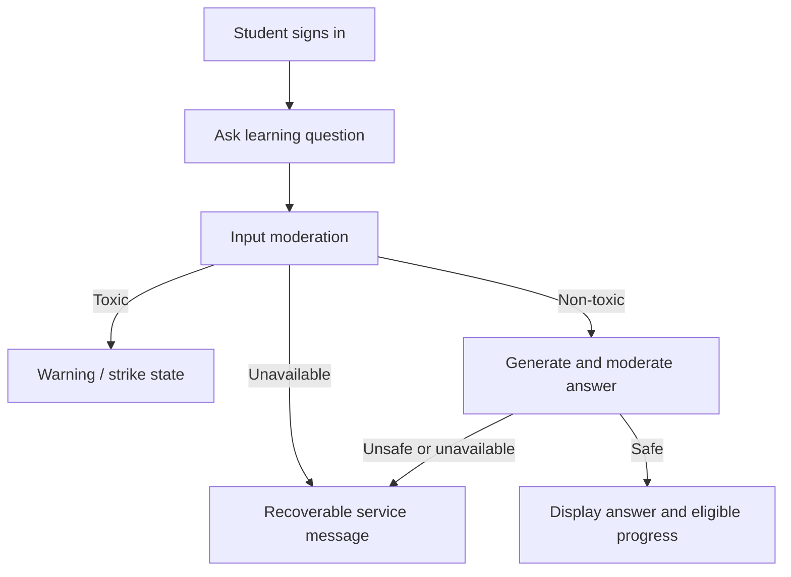

# Product Requirements Document — Academic Productivity

Last inspected: 2026-09-28. Status: source-derived current baseline plus explicitly Proposed future requirements. No approved commercial roadmap or user-research dataset was supplied.

## 1. Product Overview

Approved admin MVP (2026-09-28): central administration integrated into the existing app, backend and Supabase project. Scope: shared login, /admin/dashboard, school CRUD/status/counts, teacher list/invitation/school assignment and access status. No public admin registration or new server. First admin is manually provisioned; real email rollout remains pending. [Implementation and setup](07-ADMIN-SETUP.md).

EduBuz supports student learning through educational chat, safety feedback, teacher oversight, rewards, and cosmetic avatar collections. Current student-facing copy emphasizes PJOK learning. Its current value proposition is accessible conversational learning with visible behavioral safeguards. The application serves students and teachers; a parent dashboard exists as presentation UI. "Academic productivity" currently refers to learning support, not an implemented note-taking or scheduling suite.

## 2. Problem Statement

Current source addresses access to learning help, harmful chat interactions, and teacher awareness. These are inferred product problems, not validated research findings.

Proposed expansion hypotheses: students may struggle to organize academic information, manage notes/tasks/study activities, retrieve material quickly, and maintain consistent study habits. Notes, organization, and deadline tools could reduce cognitive load, but demand and fit must be validated before adding them. Their absence is not a defect in the existing chat scope.

## 3. Product Vision

Proposed: provide a calm, understandable learning workspace that combines reliable assistance with progress users can trust. Preserve the educational chat core first. Expansion into notes, academic tasks, or study planning requires explicit scope decisions; no long-term delivery commitment is established.

## 4. Product Goals

The following measures are Proposed and currently uninstrumented. Targets and evaluation windows are **Unknown / Needs Verification**.

| Category | Goal | Proposed measure |
| --- | --- | --- |
| Productivity | Help users complete learning interactions | Successful safe answers / eligible requests |
| Organization | Test demand for saved learning material | Task completion in a future discovery prototype |
| Usability | Make errors and progress understandable | Observed completion/error-recovery rate in usability sessions |
| Retention | Understand repeat learning use | Returning active students per agreed time window |
| Reliability | Keep rewards/safety state consistent | Duplicate awards and incorrect strike increments per retry test |
| Teacher oversight | Make actionable notifications easy to resolve | Time from notification review to appropriate action |

## 5. Non-Goals

For the current implementation baseline: no general LMS, grading system, payment platform, full calendar suite, or notes/task CRUD product is included. The product does not guarantee AI factual correctness or replace teacher judgment. Proposed extensions remain outside the current MVP until accepted.

## 6. Target Users

### Primary User: Student

Characteristics: a student asking educational questions; precise age/curriculum/device distribution is unknown. Needs: understandable answers, clear safety feedback, and accurate progress. Likely frustrations (Proposed hypotheses): waiting without feedback, confusing blocks, and rewards that do not match activity. Goals: learn and continue studying. Observed supported behavior: select role, sign in, send chat, inspect warnings/XP/EXP, rate helpful answers, and unlock/equip avatars.

### Secondary Users

Teachers view school-scoped students/notifications and reset strikes. Central administrators now manage schools, invite teachers, change their school and disable/reactivate access; live institutional and email verification remains pending. Parents have dashboard UI, but verified child linkage and permissions are not implemented in the supplied schema. Persona assumptions beyond these source-backed jobs require research.

## 7. User Problems

| Problem | User Impact | Product Response | Priority |
| --- | --- | --- | --- |
| Needs help with a learning question | Learning stalls | Current moderated chat | High |
| Harmful interaction | Unsafe learning experience | Current moderation and strike feedback | High |
| Teacher lacks incident awareness | Delayed intervention | Current school notifications/reset UI | High |
| Inconsistent progress | Loss of trust | Implemented normalization and atomic reward RPC; verification pending | High |
| Email recovery needs end-to-end verification | Account access friction | Supabase email-link/reset pages implemented; verify delivery and redirects | Medium |
| Academic material/tasks are fragmented | Harder organization | FUTURE / Proposed notes/task discovery | Unassigned until validated |

## 8. Core User Journeys

### New User Journey

Landing -> role selection -> registration -> login -> role-specific screen. Public registration permits student/parent accounts. Teacher enrollment is administrator-only; institutional provisioning procedures still need verification.

### Authentication Journey

Enter credentials -> backend verification -> browser session -> role screen. Invalid credentials show an error. Logout/session-clearing helpers exist; each UI exit control must be verified to invoke the intended behavior.

### Avatar and Reward Journey

Ask a safe learning question -> receive an eligible +1 XP award -> optionally rate the answer helpful for +2 XP -> open Avatar & XP -> preview up to three cards, inspect EXP history and reward guide -> open the full collection -> unlock an affordable avatar -> choose Pakai avatar. Unlocking does not equip automatically. Spending EXP does not reduce lifetime XP or level.

The account menu links to home, role destination, EXP overview, and full avatar collection for students; it also controls theme and logout.

### Note Management Journey

FUTURE / Proposed; no current route/API/table. Candidate journey: create a note -> save -> view/edit -> optionally categorize -> delete with clear confirmation. Adoption requires a product decision.

### Academic Task Journey

FUTURE / Proposed; no current task CRUD. Candidate journey: create study task -> optionally set due date/priority -> review/filter -> complete or edit/delete. Date/time and overdue semantics are undecided.

### Study/Productivity Journey

### Search/Organization Journey

Current: teacher student-list filtering/search in the dashboard. FUTURE / Proposed: searching notes/tasks globally after those modules are accepted and implemented. No global search is claimed.

## 9. MVP Features

This is a proposed stabilization scope for the existing product, not proof of release readiness.

| Feature | Description | User Value | Priority | Status |
| --- | --- | --- | --- | --- |
| Registration/login/session | Supabase-backed identity | Access learning | High | Implemented source; verification pending |
| Logout/profile | Session helpers and profile metadata; standalone profile page not routed | Account control | High | Partial / Needs Verification |
| Moderated chat | Input/output safety and answer flow | Learning support | High | Implemented source; external runtime unverified |
| Teacher oversight | Students, notifications, resets | Intervention | High | Implemented source; permission review pending |
| Progress | XP and level display | Motivation | High | Implemented XP/EXP/level and atomic RPC; deployment verification pending |
| Avatar economy | Earn/spend EXP, preview/full card collection, equip and history | Cosmetic personalization | High | Implemented source; DB/browser verification pending |
| Account and theme | Session-aware account menu, logout, shared light/dark preference | Account control | Medium | Implemented source; UX verification pending |
| Parent overview | Dashboard presentation | Family visibility | Medium | Demo/static; not live integration |
| Notes CRUD/search/categories | Manage saved academic information | Organization | Future | Proposed; absent |
| Academic tasks/planning/deadlines | Manage study work | Planning | Future | Proposed; absent |
| Recent notes/upcoming tasks summary | Cross-module overview | Overview | Future | Proposed; dependent modules absent |

## 10. Feature Requirements

Acceptance criteria are unchecked verification targets.

### Feature: Authentication

User story: As a user, I want to sign in and control my session so my information remains private.

- [ ] Registration creates a usable account/profile or explains failure without orphaned state.
- [ ] Invalid credentials and expired sessions produce understandable recovery paths.
- [ ] Logout invalidates the local session and protected access.
- [ ] Teacher privileges require the agreed enrollment rule.

Edge cases: duplicate email, missing profile, blocked account, refresh failure, unexpected role, partially completed registration.

### Feature: Moderated Learning Chat

User story: As a student, I want useful learning answers and clear safety feedback.

- [ ] Safe input with safe output displays an answer.
- [ ] Toxic input creates the correct strike once per logical request.
- [ ] Outages and toxic generated output do not penalize the student.
- [ ] The UI explains blocked, loading, retry, and service-unavailable states.

Edge cases: blank input, timeout after server processing, repeated requestId, malformed service output, already blocked user.

### Feature: Teacher Oversight

User story: As a teacher, I want to review my school's incidents and restore access when appropriate.

- [ ] Students and notifications are limited to the authorized school.
- [ ] Read actions update intended notifications.
- [ ] Reset affects the intended student and records an audit entry.

Edge cases: foreign-school IDs, removed student, reset/write failure, simultaneous actions, empty lists.

### Feature: Progress and Feedback

User story: As a student, I want progress to reflect eligible learning activity accurately.

- [ ] Initial load and post-chat XP/level agree.
- [ ] Retries and concurrency cannot duplicate or lose awards.
- [ ] Progress units and top-level limits render correctly.
- [ ] Feedback awards follow an agreed eligibility rule.

Edge cases: zero XP, highest level, toxic interaction, unknown requestId, duplicate helpful feedback, reward service outage.

### Feature: Cosmetic Avatar Economy

User story: As a student, I want to spend earned EXP on avatars while retaining my learning level.

- [ ] Verify lifetime XP and level remain unchanged by purchases; available EXP decreases by the server catalog price.
- [ ] Verify repeat unlock does not charge twice, concurrent spending cannot overspend, and equip requires ownership.
- [ ] Verify insufficient balance, service failure, expired session, retired owned avatars, and refresh after a timeout.
- [ ] Verify overview preview (up to three cards), full collection, 30-event history, WIB timestamps, and image fallback.

Implementation exists in UI/API/migration 004; these checkboxes represent product acceptance still requiring runtime verification. Seed prices: eight starters free, Runner 100 EXP, Astronaut 250 EXP, Dragon 500 EXP. Card rarity and illustrations are cosmetic configuration; prices and ownership are server data.

### Feature: Notes / Academic Tasks

FUTURE / Proposed user story: As a student, I want to organize notes and study tasks if that expansion is accepted.

- [ ] Scope, permissions, required fields, and deletion behavior are approved before implementation.
- [ ] CRUD, search/filter/sort, validation, and empty/loading/error states are independently specified and tested.
- [ ] Notes/tasks remain private to authorized users.

Edge cases to resolve during discovery: unsaved changes, duplicates, missing titles, time zones, overdue tasks, deleted categories. No implementation is claimed.

### Existing Reward Rules

[reward_api.py](../reward-gamification-api/reward_api.py) defines the following calculator rules. Availability of an event in the calculator does not mean its product workflow exists.

| Event | XP |
| --- | --- |
| conversation_completed | 1 |
| helpful_feedback | 2 when feedback is helpful; otherwise 0 |
| challenge_completed | 20 |
| learning_milestone | 50 |
| safe_interaction | 1 |

The active chat flow awards conversation_completed only; it does not add a separate safe_interaction bonus. Challenge, milestone, and separate safe-interaction workflows are marked unavailable in RewardGuide. Ten eligible chat awards currently produce 10 XP, not 100.

TOXIC overrides awards to 0 with BLOCK_REWARD. Level thresholds are 0, 100, 250, 500, and 1000 XP for levels 1 through 5. Badge conditions are first conversation, five helpful feedbacks, one challenge, and three streak days. Statistics supplied to badge evaluation are not persisted automatically by that service.

## 11. Functional Requirements

| ID | Requirement | Priority | Status |
| --- | --- | --- | --- |
| FR-001 | Register/login and maintain a valid session | High | Implemented source; verify |
| FR-002 | Moderate input and output around learning generation | High | Implemented source; verify remote services |
| FR-003 | Record strikes and block at three without outage penalties | High | Implemented source; concurrency verification needed |
| FR-004 | Provide school-scoped teacher reads/actions | High | Implemented source; trust model unresolved |
| FR-005 | Show durable consistent XP/levels and spendable EXP | High | Normalization and atomic RPC implemented; verify live schema |
| FR-006 | Award eligible helpful feedback once | Medium | UI and same-ID deduplication implemented; server validates owned safe rewarded conversations; local negative/replay tests pass |
| FR-007 | Persist badges/streaks/challenges if accepted | Future | Proposed; calculator support only |
| FR-008 | Support verified logged-out account recovery | Medium | Email recovery/reset implemented; live email and browser verification pending |
| FR-009 | Provide authorized parent monitoring if accepted | Future | Proposed; static UI only |
| FR-010 | Provide private notes CRUD/organization if accepted | Future | Proposed; absent |
| FR-011 | Provide academic tasks/due dates/status if accepted | Future | Proposed; absent |

| FR-012 | Unlock/equip owned cosmetic avatars without reducing lifetime XP/level | High | UI/API/SQL implemented; verification pending |
| FR-013 | Show recent EXP history and distinguish available reward activities | Medium | Latest 30 events, WIB, and RewardGuide implemented |
| FR-014 | Provide account navigation, logout and a persisted shared theme | Medium | Implemented source; browser acceptance pending |

FR-001 through FR-009 supersede the earlier FR-01 through FR-09 labels; their scope remains traceable by number.

## 12. Non-Functional Requirements

| Area | Requirement / verification target | Current evidence |
| --- | --- | --- |
| Performance | Proposed agreed end-to-end latency/error budget | Timeouts exist; measured targets unknown |
| Security | Verify identity, ownership, role, school boundaries | Middleware/RLS exist with review gaps |
| Accessibility | Proposed keyboard, focus, contrast, meaningful labels | No conformance audit |
| Reliability | Avoid false strikes and inconsistent rewards | Safety branches and atomic economy RPCs exist; transactional strike/reset RPCs implemented in migration 006; database verification pending |
| Maintainability | Keep documented API/schema/UI contracts aligned | Six living docs and existing component/service boundaries |
| Scalability | Proposed load tests before scale promises | Capacity unknown; no adopted caching design |
| Responsiveness | Usable mobile/desktop core flows | Responsive classes present; device tests pending |

## 13. UX Requirements

Proposed acceptance standard: simple role-appropriate navigation, clear visual hierarchy, one obvious primary action, readable feedback, and consistent spacing. Preserve current warm palette while avoiding added decorative complexity. Every main screen must distinguish empty data from failed loading; blocked access must explain the next valid step. See [design system](05-DESIGN-SYSTEM.md).

## 14. Data Requirements

Current product data: identity/profile, role/school grouping, strike incidents, teacher notifications, reset audit, lifetime XP, spent/available EXP, reward/purchase events, avatar catalog, ownership, and equipped avatar. Violations can include message text, so retention and authorized visibility require decisions. Durable chat history, parent-child relationships, note content, academic task dates, streak history, and badge ownership are not established schema capabilities.

## 15. Permission / Role Requirements

Current roles: student, teacher, parent, admin. The backend validates identity and blocked state; teacher actions add role checks and school scoping. Proposed requirement: enrollment must establish trusted roles/school membership. Parent-child visibility remains undefined. Chat/reward/avatar endpoints now enforce the student role and feedback requires an owned rewarded safe conversation. UI hiding is not permission enforcement.

## 16. Error & Edge Cases

| Case | Expected product behavior | Verification status |
| --- | --- | --- |
| Invalid login/input | Specific actionable message; no unintended mutation | Validation exists; UX verification pending |
| Expired session / unauthorized action | Explain sign-in/access requirement; do not show protected data | Server checks exist; full UI recovery pending |
| Empty data | Explain absence and available action | Page-local states; coverage pending |
| API/network failure | Preserve input when appropriate and offer safe retry | Pending end-to-end test |
| Duplicate request | No duplicate penalty/reward | Economy RPC deduplicates; strike flow still needs verification |
| Unavailable moderation | No generation and no student strike | Source branch exists |
| Unsafe generated output | Withhold answer without student penalty | Source branch exists |

## 17. Success Criteria

Proposed stabilization gate: authentication and school isolation verified; safe/toxic/outage chat scenarios behave as specified; reward totals survive retry/concurrency; mobile/desktop core journeys and error recovery are usable. Adoption metrics require a baseline and approved measurement period. No success percentage is fabricated.

## 18. MVP Scope

### Included

Proposed stabilization of existing account/session, moderated chat, student safety/progress, helpful feedback, avatar economy/history, account/theme controls, and teacher oversight.

### Not Included

Notes/tasks/calendar CRUD, live parent monitoring, complete challenge/streak tracking, payments, and LMS integrations until separately accepted. Existing calculator event types and static dashboards do not change this boundary.

## 19. Future Features

FUTURE / Proposed: notes management, academic tasks/study planning, global search after those modules exist, persisted badges/streaks/challenges, and authorized parent visibility. Reminders, calendars, collaboration, and integrations are discovery candidates only. No schedule or commitment is assigned.

## 20. Product Risks

Adoption: inferred needs may not match users. Complexity: expanding beyond chat may fragment the experience. Technical: external AI dependency, deployment contract drift, unverified economy transactions, and unverified deployed strike/reset RPCs. Data/security: unverified teacher identity, RLS, and retention. UX: static dashboards or inaccurate XP can suggest capabilities the product cannot deliver. Mitigation work belongs in the [task register](06-PROJECT-TASKS.md).

## 21. Product Change Log

| Date | Change | Reason |
| --- | --- | --- |
| 2026-09-27 | Added avatar/EXP, helpful feedback, account/theme journeys and current +1 chat reward | Match implemented product scope |
| 2026-09-26 | Captured current chat/safety/reward baseline | Avoid claiming unsupported productivity modules |
| 2026-09-26 | Expanded journeys, requirements, acceptance criteria, and proposed expansion boundaries | Match complete requested PRD structure without inventing approvals |

> This PRD defines product requirements. Technical implementation details belong in the system architecture and development rules documents.
