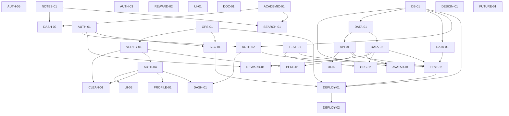

# Project Tasks & Development Plan

Last inspected: 2026-09-28. Source-derived master register; priorities and future work are proposals, not an approved delivery schedule. Source presence is distinguished from verified completion.

## 1. Purpose

Track deliverables, acceptance criteria, dependencies, and verification for the existing application and clearly marked future discoveries. Preserve existing task IDs for traceability. No notes/task/calendar implementation is implied by the roadmap phase names. Product scope is in the [PRD](03-PRD-ACADEMIC-PRODUCTIVITY.md).

## 2. Task Status Legend

| Status | Meaning |
| --- | --- |
| TODO | Not started; can be a proposed verification/discovery task |
| IN_PROGRESS | Actively assigned and being developed |
| BLOCKED | Cannot continue; record specific reason and next unblock action |
| REVIEW | Implementation complete, awaiting required verification |
| DONE | Deliverable exists, criteria checked, and relevant checks pass |
| CANCELLED | Explicitly no longer required; preserve reason/history |

Uncertainty about runtime does not automatically mean BLOCKED. No active application sprint is evidenced.

## 3. Priority Legend

| Priority | Meaning |
| --- | --- |
| P0 | Critical |
| P1 | High |
| P2 | Medium |
| P3 | Low |

Priority is independent of phase number and does not imply a deadline. No current task is marked P0 without evidence justifying it.

## 4. Overall Progress

Counts reflect the records below, including proposed discovery work; they are not product completion percentages. REVIEW means source exists but required runtime acceptance remains. CANCELLED: 0.

| Phase | Total | Done | Review | In Progress | TODO | Blocked |
| --- | ---: | ---: | ---: | ---: | ---: | ---: |
| 1. Project Setup | 6 | 1 | 5 | 0 | 0 | 0 |
| 2. Authentication | 5 | 2 | 3 | 0 | 0 | 0 |
| 3. User & Profile | 2 | 0 | 1 | 0 | 1 | 0 |
| 4. Notes Management | 1 | 0 | 0 | 0 | 1 | 0 |
| 5. Academic Task Management | 1 | 0 | 0 | 0 | 1 | 0 |
| 6. Dashboard & Productivity | 7 | 1 | 3 | 0 | 3 | 0 |
| 7. Search & Organization | 1 | 0 | 0 | 0 | 1 | 0 |
| 8. Design System & UX | 3 | 0 | 1 | 0 | 2 | 0 |
| 9. Testing & Security | 6 | 1 | 4 | 0 | 1 | 0 |
| 10. Performance & Quality | 3 | 0 | 1 | 0 | 2 | 0 |
| 11. Deployment | 3 | 0 | 1 | 0 | 2 | 0 |
| 12. Post-MVP | 2 | 0 | 0 | 0 | 2 | 0 |
| **Total** | **40** | **5** | **19** | **0** | **16** | **0** |

## 5. Phase 1 — Project Setup

### DATA-01 — Compatible moderation-label migration and persistence contract

Priority: P1  
Status: REVIEW  
Depends On: DB-01  
Owner: Unassigned  
Estimated Effort: Not estimated  
Scope: CURRENT stabilization proposal

Description: Migration 004 converts SAFE/UNSAFE history and replaces the constraint with NON_TOXIC/TOXIC, matching TS/Python. Implementation exists; verify fresh installation and upgrade in PostgreSQL.

Deliverables:
- Compatible moderation-label migration and persistence contract.

Acceptance Criteria:
- [ ] Chosen vocabulary is explicit across SQL/TS/Python; new and existing DB paths accept valid events and reject invalid values; existing data conversion is verified.

Files / Areas:
- supabase/migrations/004_avatar_economy.sql; backend-vite/src/services/gamificationService.ts; reward-gamification-api/reward_api.py.

Notes: Source reviewed 2026-09-27. Applied database state and data conversion were not tested; REVIEW does not mean deployed.

### DB-01 — Reproducible migration discovery/order and schema verification record

Priority: P1  
Status: REVIEW  
Depends On: None  
Owner: Unassigned  
Estimated Effort: Not estimated  
Scope: CURRENT stabilization proposal

Description: Ordered migrations.json now includes 001, 002, nested 003, 004, 005 and 006. test_local.py implements disposable PostgreSQL upgrade, RLS, economy and strike tests.

Deliverables:
- Reproducible migration discovery/order and schema verification record.

Acceptance Criteria:
- [ ] Reproducible schema setup and upgrade path on disposable DB; actual constraints/policies documented; no claim based only on file presence.

Files / Areas:
- supabase/migrations; backend-vite/src/services/supabaseService.ts.

Notes: Docker prerequisite check on 2026-09-28 failed because the daemon pipe was unavailable; database harness not run. Applied Supabase history remains unknown.

### OPS-01 — Safe configuration example and reproducible component startup/runtime record

Priority: P2  
Status: REVIEW  
Depends On: None  
Owner: Unassigned  
Estimated Effort: Not estimated  
Scope: CURRENT stabilization proposal

Description: Backend/reward .env.example, reward requirements-tested.txt and start-local.ps1 are available. CORS_ORIGINS is configurable.

Deliverables:
- Safe configuration example and reproducible component startup/runtime record.

Acceptance Criteria:
- [ ] Supported runtimes, safe environment template, startup steps, and dependency resolution validated without secrets.

Files / Areas:
- frontend-vite/package.json; backend-vite/package.json; reward-gamification-api/requirements.txt; docs/01-SYSTEM-ARCHITECTURE.md.

Notes: Builds and local tests pass with existing dependencies. Clean installation, full dependency locking and supported runtime matrix remain unverified.

### DOC-01 — Six structured English documents and README reading order.

Priority: P2  
Status: DONE  
Depends On: None  
Owner: Unassigned  
Estimated Effort: Not estimated  
Scope: CURRENT documentation

Description: Synchronize six living documents, root/component READMEs, and avatar asset guide with current source and actual local checks.

Deliverables:
- Six structured English documents and README reading order..

Acceptance Criteria:
- [x] All required numbered sections exist; local links/fences and roadmap totals/dependencies validate; source-based facts and proposed scope remain distinct.

Files / Areas:
- README.md; docs/*.md; frontend-vite/README.md; backend-vite/README.md; reward-gamification-api/README.md; frontend-vite/public/avatars/README.md.

Notes: Updated 2026-09-28: source contracts, routes, migrations, reward values, shared UI/theme, task statuses and validation record. Local documentation links, anchors, fences and register counts checked. Historical 2026-09-26 structure/count records are superseded by the current table.

### VERIFY-01 — Recorded frontend build/lint and backend build/test baseline, plus authorized health/CORS smoke results.

Priority: P1  
Status: REVIEW  
Depends On: OPS-01  
Owner: Unassigned  
Estimated Effort: Not estimated  
Scope: CURRENT verification/stabilization proposal

Description: Current build/lint/test baseline and local HTTP health/CORS/error checks are recorded in section 22.

Deliverables:
- Recorded frontend build/lint and backend build/test baseline, plus authorized health/CORS smoke results..

Acceptance Criteria:
- [ ] Run existing commands in component directories; record pass/failure and prerequisites; test browser API origin/unauthorized/error paths without claiming unavailable services passed.

Files / Areas:
- frontend-vite/package.json; backend-vite/package.json; backend-vite/src/server.ts; frontend-vite/src/services/apiClient.ts.

Notes: Both builds and frontend lint pass; 16 backend and 5 Python tests pass. Browser and live integration acceptance remain open.

### ADMIN-01 - School schema, admin role and transactional audit

Priority: P1  
Status: REVIEW  
Depends On: None  
Owner: Unassigned  
Estimated Effort: Not estimated  
Scope: APPROVED admin MVP

Description: Migration 007 preserves legacy TEXT IDs and adds schools/FK, invitations, admin audit and effective teacher RLS.

Deliverables:
- School schema, admin role and transactional audit.

Acceptance Criteria:
- [x] Disposable PostgreSQL executes 001-007; legacy IDs, FK, CRUD, invitation uniqueness, privilege denial and audit rollback pass.
- [ ] Inspect custom deployed policies/triggers and apply migration to target Supabase.

Files / Areas:
- supabase/migrations/007_admin_schools.sql; supabase/migrations.json; supabase/test_admin.cjs.

Notes: Local implementation verified on 2026-09-28. No live Supabase migration or email was performed; deployment is tracked separately by ADMIN-05.

## 6. Phase 2 — Authentication

### AUTH-05 — Isolate login sessions from privileged Supabase writes

Priority: P1
Status: DONE
Depends On: None
Owner: Unassigned
Estimated Effort: Not estimated
Scope: CURRENT bug fix; local regression verification

Description: Fresh createLoginClient() per login remains implemented. This resolved the historical shared-admin session contamination; current regression fixtures now support the economy RPC.

Deliverables:
- Fresh createLoginClient() per login request; shared admin client retains server authorization.
- Real-SDK/local-HTTP regression tests with no live account/database mutation.

Acceptance Criteria:
- [x] Reproduce the reported RLS failure before the fix.
- [x] Historical fixture: ten +10 stub rewards persisted 100 XP/level 2 before RPC migration. Current product reward is +1 per eligible chat.
- [x] Concurrent logins and invalid credentials do not contaminate admin writes; toxic reward remains zero.
- [x] Backend build and both new regression scenarios passed on 2026-09-26; current test status is recorded below.

Files / Areas:
- backend-vite/src/services/supabaseService.ts
- backend-vite/src/controllers/authController.ts
- backend-vite/test/gamificationAuthIsolation.test.cjs
- docs/01-SYSTEM-ARCHITECTURE.md; docs/02-PROJECT-MEMORY.md; docs/04-DEVELOPMENT-RULES.md; docs/06-PROJECT-TASKS.md

Notes: Historical 2026-09-26 build and two regression checks passed before avatar changes. The 2026-09-27 fixture failures are historical: RPC stubs and +1 rewards are now updated, and both isolation scenarios pass within the 16-test suite on 2026-09-28. See section 22.

### AUTH-01 — Documented trusted enrollment rule and server enforcement

Priority: P1  
Status: REVIEW  
Depends On: None  
Owner: Unassigned  
Estimated Effort: Not estimated  
Scope: CURRENT stabilization proposal

Description: Public registration rejects teacher role with 403 and invalid roles with 400; teachers must be provisioned by an administrator. Student/parent registration validates email, password, name, grade and starter avatar.

Deliverables:
- Documented trusted enrollment rule and server enforcement.

Acceptance Criteria:
- [ ] Approved enrollment rule enforced server-side; unverified users cannot obtain another school's teacher privileges; tests cover forbidden cases.

Files / Areas:
- backend-vite/src/controllers/authController.ts; frontend-vite/src/pages/Register.tsx.

Notes: Local API tests verify role rejection. Admin invitation and explicit school selection are implemented. Real institution mapping/email verification and legacy-group review remain rollout requirements; new users are not assigned by email domain.

### AUTH-03 — Verified recovery flow or explicitly limited supported UI

Priority: P2  
Status: REVIEW  
Depends On: None  
Owner: Unassigned  
Estimated Effort: Not estimated  
Scope: CURRENT stabilization proposal

Description: ForgotPassword sends Supabase recovery email; ResetPassword validates the current user, checks password confirmation, updates the password and attempts logout.

Deliverables:
- Verified recovery flow or explicitly limited supported UI.

Acceptance Criteria:
- [ ] Approved real recovery flow verifies ownership and supports logged-out users, or UI clearly limits itself to supported behavior; no local OTP security claim.

Files / Areas:
- frontend-vite/src/pages/ForgotPassword.tsx; frontend-vite/src/pages/ResetPassword.tsx; frontend-vite/src/store/authStore.ts.

Notes: Source and build/lint verified. Supabase redirect allowlist, email delivery, expired links and logged-out browser flow require end-to-end verification.

### AUTH-04 — Auth behavior matrix and focused regression checks for existing flows.

Priority: P1  
Status: REVIEW  
Depends On: VERIFY-01  
Owner: Unassigned  
Estimated Effort: Not estimated  
Scope: CURRENT verification/stabilization proposal

Description: Lazy role routes use ProtectedRoute and GET /api/auth/me. Server checks session, blocked state and role; student-only middleware protects chat and /api/me.

Deliverables:
- Auth behavior matrix and focused regression checks for existing flows..

Acceptance Criteria:
- [ ] Valid/invalid credentials, missing profiles, expiry/refresh, blocked users, direct routes, and each logout control have recorded outcomes; failed cases get bounded fix tasks.

Files / Areas:
- frontend-vite/src/pages/Login.tsx; frontend-vite/src/pages/StudentChat.tsx; frontend-vite/src/store/authStore.ts; backend-vite/src/middleware/auth.ts.

Notes: API tests cover missing/invalid/blocked sessions and role boundaries. Browser expiry/refresh/direct-navigation/logout matrix remains open.

### ADMIN-02 - Shared admin authentication and authorization

Priority: P1  
Status: DONE  
Depends On: None  
Owner: Unassigned  
Estimated Effort: Not estimated  
Scope: APPROVED admin MVP

Description: Existing login and role wrappers support admin while retaining parent; every admin endpoint checks the verified role.

Deliverables:
- Shared admin authentication and authorization.

Acceptance Criteria:
- [x] Local API/browser tests verify missing/blocked/non-admin denial, actual-role redirects and admin login. Public admin and school self-assignment are rejected.

Files / Areas:
- backend-vite/src/middleware/auth.ts; backend-vite/src/routes/adminRoutes.ts; frontend-vite/src/components/ProtectedRoute.tsx; frontend-vite/src/pages/Login.tsx.

Notes: Local implementation verified on 2026-09-28. No live Supabase migration or email was performed; deployment is tracked separately by ADMIN-05.

## 7. Phase 3 — User & Profile

### PROFILE-01 — Account/profile field inventory and decision on unrouted Profile.tsx.

Priority: P2  
Status: TODO  
Depends On: AUTH-04  
Owner: Unassigned  
Estimated Effort: Not estimated  
Scope: CURRENT verification/stabilization proposal

Description: AccountMenu and useHomeAccount now provide session-aware identity, points, theme, navigation and logout. Verify profile initialization and decide whether standalone unrouted Profile.tsx is still needed.

Deliverables:
- Account/profile field inventory and decision on unrouted Profile.tsx..

Acceptance Criteria:
- [ ] Name/avatar/grade defaults are traced from registration to reads; editable fields and role permissions are explicit; route adoption or non-use is documented.

Files / Areas:
- frontend-vite/src/pages/Profile.tsx; frontend-vite/src/pages/Register.tsx; backend-vite/src/controllers/authController.ts.

Notes: Shared account UI is implemented; profile-edit scope and all-role runtime acceptance remain open.

### AVATAR-01 — Verify implemented avatar economy end to end

Priority: P1  
Status: REVIEW  
Depends On: DB-01, DATA-02  
Owner: Unassigned  
Estimated Effort: Not estimated  
Scope: CURRENT implementation awaiting integration verification

Description: Avatar collection/preview, unlock/equip, authoritative EXP, card customization and 30-event WIB history exist in UI/API/SQL.

Deliverables:
- AvatarCollection/FullAvatarCollection, AvatarCard/ExpHistory/RewardGuide, avatar service/controller and migration 004.

Acceptance Criteria:
- [x] Routes, endpoint contracts, seed catalog and ownership/spending logic inspected in source.
- [ ] Verify insufficient EXP, duplicate unlock, concurrent earning/spending, invalid/unowned equip, retired owned avatars and timeout refresh against PostgreSQL.
- [ ] Verify XP/level never decrease from purchases and browser inputs cannot override user, price or balance.
- [ ] Verify responsive cards, missing-image fallback, latest 30 events and WIB dates in a browser.

Files / Areas:
- frontend-vite/src/pages/AvatarCollection.tsx; frontend-vite/src/components/AvatarCard.tsx; backend-vite/src/services/avatarService.ts; supabase/migrations/004_avatar_economy.sql.

Notes: Implementation reviewed on 2026-09-27; builds pass. Migration application and browser/database acceptance were not performed in this documentation pass.

## 8. Phase 4 — Notes Management

FUTURE / Proposed. Deliverables in this phase are bounded discovery decisions; implementation tasks must be added only after scope is accepted.

### NOTES-01 — FUTURE notes brief covering create/read/edit/delete, validation, categories, search/filter/sort, and UI states.

Priority: P3  
Status: TODO  
Depends On: None  
Owner: Unassigned  
Estimated Effort: Not estimated  
Scope: FUTURE / Proposed discovery; no notes implementation

Description: Decide whether notes belong in the product.

Deliverables:
- FUTURE notes brief covering create/read/edit/delete, validation, categories, search/filter/sort, and UI states..

Acceptance Criteria:
- [ ] Record accepted/deferred/rejected scope; if accepted, specify privacy and required fields and split CRUD/search/state work into verifiable tasks before implementing.

Files / Areas:
- docs/03-PRD-ACADEMIC-PRODUCTIVITY.md.

Notes: No completion or active assignment is claimed. Record changed files and actual check outcomes before moving to DONE.

## 9. Phase 5 — Academic Task Management

FUTURE / Proposed. Deliverables in this phase are bounded discovery decisions; implementation tasks must be added only after scope is accepted.

### ACADEMIC-01 — FUTURE task brief covering create/edit/delete/complete, due dates, priority/status, filtering/sorting.

Priority: P3  
Status: TODO  
Depends On: None  
Owner: Unassigned  
Estimated Effort: Not estimated  
Scope: FUTURE / Proposed discovery; no task CRUD implementation

Description: Decide whether academic task management belongs in the product.

Deliverables:
- FUTURE task brief covering create/edit/delete/complete, due dates, priority/status, filtering/sorting..

Acceptance Criteria:
- [ ] Record accepted/deferred/rejected scope; define date/time and ownership rules if accepted; break implementation into separate verifiable tasks.

Files / Areas:
- docs/03-PRD-ACADEMIC-PRODUCTIVITY.md.

Notes: No completion or active assignment is claimed. Record changed files and actual check outcomes before moving to DONE.

## 10. Phase 6 — Dashboard & Productivity

### API-01 — Normalized progress contract for GET and chat, with defined fraction/percentage units

Priority: P1  
Status: REVIEW  
Depends On: DATA-01  
Owner: Unassigned  
Estimated Effort: Not estimated  
Scope: CURRENT stabilization proposal

Description: GET and chat now expose levelInfo and expBalance. apiClient normalizes xp/newXp and numeric/object level; StudentChat displays EXP, lifetime XP and level. progress_to_next_level remains a 0..1 fraction; the old percentage bar is absent.

Deliverables:
- Normalized progress contract for GET and chat, with defined fraction/percentage units.

Acceptance Criteria:
- [ ] Typed shared/normalized contract; XP, level name, progress, and missing stats render correctly after initial load and chat.

Files / Areas:
- frontend-vite/src/services/apiClient.ts; frontend-vite/src/pages/StudentChat.tsx; backend-vite/src/services/chatService.ts; backend-vite/src/services/gamificationService.ts.

Notes: Source implementation reviewed 2026-09-27; verify refresh, post-chat and post-feedback agreement against a database migrated through 007. Streak/count/badge data are still default placeholders.

### REWARD-01 — Feedback role/interaction eligibility and replay enforcement

Priority: P2  
Status: REVIEW  
Depends On: AUTH-01, DATA-02  
Owner: Unassigned  
Estimated Effort: Not estimated  
Scope: CURRENT stabilization proposal

Description: Feedback requires a nonempty requestId up to 200 characters and an owned NON_TOXIC conversation_completed event with positive reward. Student middleware enforces role; SQL deduplicates awards.

Deliverables:
- Feedback role/interaction eligibility and replay enforcement.

Acceptance Criteria:
- [ ] Role and interaction ownership rules are explicit; repeated/new request IDs cannot bypass reward eligibility; negative cases tested.

Files / Areas:
- backend-vite/src/controllers/studentController.ts; backend-vite/src/services/gamificationService.ts.

Notes: Local tests cover missing/arbitrary/foreign IDs, authenticated identity and replay results. Real database replay/concurrency acceptance remains pending.

### UI-01 — Explicit parent-dashboard demo/live scope decision and bounded follow-ups

Priority: P2  
Status: TODO  
Depends On: None  
Owner: Unassigned  
Estimated Effort: Not estimated  
Scope: FUTURE / Proposed scope decision

Description: Decide parent dashboard data integration. Current page contains static presentation data.

Deliverables:
- Explicit parent-dashboard demo/live scope decision and bounded follow-ups.

Acceptance Criteria:
- [ ] Record the chosen supported scope, identify UI/API/schema implications, and create small implementation tasks with owners/dependencies; do not claim the complete feature from this decision alone.

Files / Areas:
- frontend-vite/src/pages/ParentDashboard.tsx; docs/03-PRD-ACADEMIC-PRODUCTIVITY.md.

Notes: No completion or active assignment is claimed. Record changed files and actual check outcomes before moving to DONE.

### DASH-01 — Dashboard data-source inventory and manual/API scenario results.

Priority: P2  
Status: TODO  
Depends On: AUTH-04, AUTH-02  
Owner: Unassigned  
Estimated Effort: Not estimated  
Scope: CURRENT verification/stabilization proposal

Description: Verify existing teacher overview and empty/error states.

Deliverables:
- Dashboard data-source inventory and manual/API scenario results..

Acceptance Criteria:
- [ ] Summary cards, notifications, search/filters, reset refresh, empty and failed responses are traced to actual data; static/demo metrics are identified.

Files / Areas:
- frontend-vite/src/pages/TeacherDashboard.tsx; backend-vite/src/controllers/teacherController.ts.

Notes: No completion or active assignment is claimed. Record changed files and actual check outcomes before moving to DONE.

### DASH-02 — Dependency-aware dashboard proposal.

Priority: P3  
Status: TODO  
Depends On: NOTES-01, ACADEMIC-01  
Owner: Unassigned  
Estimated Effort: Not estimated  
Scope: FUTURE / Proposed; scope decisions are dependencies, not implemented modules

Description: Decide future recent-notes/upcoming-tasks/productivity summaries.

Deliverables:
- Dependency-aware dashboard proposal..

Acceptance Criteria:
- [ ] No dashboard counters are claimed without accepted upstream models and calculations; specify empty/error behavior and defer implementation until source modules exist.

Files / Areas:
- docs/03-PRD-ACADEMIC-PRODUCTIVITY.md.

Notes: No completion or active assignment is claimed. Record changed files and actual check outcomes before moving to DONE.

### ADMIN-03 - School management and responsive dashboard

Priority: P1  
Status: DONE  
Depends On: ADMIN-02  
Owner: Unassigned  
Estimated Effort: Not estimated  
Scope: APPROVED admin MVP

Description: Admin can create/edit/activate/deactivate schools, see actual teacher counts and filter teachers by school.

Deliverables:
- School management and responsive dashboard.

Acceptance Criteria:
- [x] Local API/SQL tests verify CRUD, duplicate codes, invalid fields and inactive-school access. Browser checks verify school creation and 390px containment.

Files / Areas:
- backend-vite/src/services/adminService.ts; frontend-vite/src/pages/AdminDashboard.tsx; frontend-vite/src/services/adminApi.ts.

Notes: Local implementation verified on 2026-09-28. No live Supabase migration or email was performed; deployment is tracked separately by ADMIN-05.

### ADMIN-04 - Teacher invitation, assignment, activation and access status

Priority: P1  
Status: REVIEW  
Depends On: ADMIN-01, ADMIN-02  
Owner: Unassigned  
Estimated Effort: Not estimated  
Scope: APPROVED admin MVP

Description: Server reserves email, invokes Supabase invitation and inserts a teacher profile for the selected school. Admin can move and disable/reactivate teachers. Failed reservations remain visible.

Deliverables:
- Teacher invitation, assignment, activation and access status.

Acceptance Criteria:
- [x] Local API/SQL/browser checks cover invite, ownership, replay, transfer, disabled access, provider errors and password activation.
- [ ] Verify real email receipt, expired links and deployed activation/login.

Files / Areas:
- backend-vite/src/services/adminService.ts; backend-vite/src/controllers/invitationController.ts; frontend-vite/src/pages/AcceptInvite.tsx.

Notes: Local implementation verified on 2026-09-28. No live Supabase migration or email was performed; deployment is tracked separately by ADMIN-05.

## 11. Phase 7 — Search & Organization

FUTURE / Proposed. Deliverables in this phase are bounded discovery decisions; implementation tasks must be added only after scope is accepted.

### SEARCH-01 — Search brief for fields, privacy, filters, categories/tags, sorting, and empty results.

Priority: P3  
Status: TODO  
Depends On: NOTES-01, ACADEMIC-01  
Owner: Unassigned  
Estimated Effort: Not estimated  
Scope: FUTURE / Proposed discovery

Description: Define future search/organization only for accepted content modules.

Deliverables:
- Search brief for fields, privacy, filters, categories/tags, sorting, and empty results..

Acceptance Criteria:
- [ ] Document accepted modules and query semantics; decide whether existing teacher search suffices; do not invent a current global-search endpoint.

Files / Areas:
- docs/03-PRD-ACADEMIC-PRODUCTIVITY.md; frontend-vite/src/pages/TeacherDashboard.tsx.

Notes: No completion or active assignment is claimed. Record changed files and actual check outcomes before moving to DONE.

## 12. Phase 8 — Design System & UX

### UI-02 — Representative accessibility/responsive audit and separately tracked fixes

Priority: P2  
Status: TODO  
Depends On: API-01  
Owner: Unassigned  
Estimated Effort: Not estimated  
Scope: CURRENT stabilization proposal

Description: Review token reuse, contrast, keyboard/modal behavior, mobile layout, and reduced motion.

Deliverables:
- Representative accessibility/responsive audit and separately tracked fixes.

Acceptance Criteria:
- [ ] Documented representative checks; fixes preserve warning clarity and usable focus; no untested accessibility claim.

Files / Areas:
- frontend-vite/src/pages; frontend-vite/src/components; frontend-vite/tailwind.config.js.

Notes: No completion or active assignment is claimed. Record changed files and actual check outcomes before moving to DONE.

### DESIGN-01 — Inventory of repeated buttons/inputs/cards/navigation and an extraction proposal.

Priority: P2  
Status: TODO  
Depends On: None  
Owner: Unassigned  
Estimated Effort: Not estimated  
Scope: CURRENT verification/stabilization proposal

Description: Review repeated typography/color/spacing/control styles before extracting UI.

Deliverables:
- Inventory of repeated buttons/inputs/cards/navigation and an extraction proposal..

Acceptance Criteria:
- [ ] Confirm actual repetition and state requirements; preserve palette/assets; map proposed tokens to implemented utilities; list separately scoped changes rather than rewriting all pages.

Files / Areas:
- frontend-vite/tailwind.config.js; frontend-vite/src/styles/globals.css; frontend-vite/src/pages; docs/05-DESIGN-SYSTEM.md.

Notes: No completion or active assignment is claimed. Record changed files and actual check outcomes before moving to DONE.

### UI-03 — Verify shared account, logout and persisted theme behavior

Priority: P2  
Status: REVIEW  
Depends On: AUTH-04  
Owner: Unassigned  
Estimated Effort: Not estimated  
Scope: CURRENT implementation awaiting browser verification

Description: AccountMenu, useHomeAccount, useTheme and startup initialization provide session-aware navigation, points, logout and a light/dark preference synchronized across components/tabs.

Deliverables:
- Native dialog drawer, role destinations, theme toggle, error handling and saved edubuz_theme preference.

Acceptance Criteria:
- [x] Components, hooks, startup initialization and CSS overrides inspected in source.
- [ ] Verify reload, multiple tabs, sign-out errors, account changes, keyboard/focus, mobile layout and contrast across representative pages.

Files / Areas:
- frontend-vite/src/components/AccountMenu.tsx; frontend-vite/src/hooks; frontend-vite/src/main.tsx; frontend-vite/src/styles/globals.css.

Notes: Frontend build passes; no browser/accessibility certification is claimed.

## 13. Phase 9 — Testing & Security

### DATA-02 — Atomic/idempotent reward persistence and retry/concurrency regression coverage

Priority: P1  
Status: REVIEW  
Depends On: DATA-01  
Owner: Unassigned  
Estimated Effort: Not estimated  
Scope: CURRENT stabilization proposal

Description: persistReward now calls credit_learning_reward. Migration 004 locks the progress row, checks request/event duplicates before mutation, credits a delta, and records the event atomically; unlock_avatar shares the lock.

Deliverables:
- Atomic/idempotent reward persistence and retry/concurrency regression coverage.

Acceptance Criteria:
- [ ] Retry awards once; concurrent distinct events retain both awards; partial failure cannot leave total/event disagreement; add regression tests.

Files / Areas:
- backend-vite/src/services/gamificationService.ts; supabase/migrations/004_avatar_economy.sql; backend-vite/test/gamificationAuthIsolation.test.cjs.

Notes: Source implementation confirmed 2026-09-27. Real PostgreSQL replay, concurrent earning/spending, and rollback tests remain required. Auth regression stubs now implement the RPC and pass; the real database harness awaits Docker.

### DATA-03 — Ownership-safe strike/reset persistence with duplicate/concurrency/failure checks

Priority: P1  
Status: REVIEW  
Depends On: DB-01  
Owner: Unassigned  
Estimated Effort: Not estimated  
Scope: CURRENT stabilization proposal

Description: Migration 006 adds record_student_strike/reset_student_strikes with profile locks, atomic notification/audit writes and student-scoped request IDs. strikeService calls these RPCs.

Deliverables:
- Ownership-safe strike/reset persistence with duplicate/concurrency/failure checks.

Acceptance Criteria:
- [ ] Same-request retries and concurrent requests give correct counts; cross-user IDs cannot reuse another user's outcome; reset and audit remain consistent.

Files / Areas:
- backend-vite/src/services/strikeService.ts; supabase/migrations.

Notes: API tests cover server-owned reset identity and foreign-school errors. SQL harness covers concurrency, replay and rollback but was not run because Docker is unavailable.

### AUTH-02 — Verified effective RLS/grants and least-privilege profile behavior

Priority: P1  
Status: REVIEW  
Depends On: DB-01, AUTH-01  
Owner: Unassigned  
Estimated Effort: Not estimated  
Scope: CURRENT stabilization proposal

Description: Migration 005 replaces recursive teacher profile policy with is_school_teacher and limits browser profile updates to name/grade. Migration 006 restricts strike/reset RPCs to service_role.

Deliverables:
- Verified effective RLS/grants and least-privilege profile behavior.

Acceptance Criteria:
- [ ] Browser cannot alter role/school/strike/progress authority; own/same-school/cross-school reads behave as intended; policies work without recursive failure.

Files / Areas:
- supabase/migrations; backend-vite/src/middleware/auth.ts.

Notes: Source and disposable database assertions exist; effective deployed policies/grants remain unverified. Docker harness was not run in this pass.

### TEST-01 — Current moderation/generator/reward contract tests and recorded results

Priority: P1  
Status: DONE  
Depends On: None  
Owner: Unassigned  
Estimated Effort: Not estimated  
Scope: CURRENT stabilization proposal

Description: Moderation/generator fixtures now use current labels and request_id. Login tests stub economy RPCs and +1 chat rewards. API boundary and Python reward tests extend coverage.

Deliverables:
- Current moderation/generator contract tests and recorded results.

Acceptance Criteria:
- [x] Explicit intended contract; tests cover non-toxic/toxic/outage/malformed response/output rejection; backend checks report real results.

Files / Areas:
- backend-vite/test/moderationService.test.cjs; backend-vite/test/gamificationAuthIsolation.test.cjs; backend-vite/test/apiBoundaries.test.cjs; reward-gamification-api/test_reward_api.py; backend-vite/src/services.

Notes: 2026-09-28: 16/16 backend tests and 5/5 Python tests pass. Backend cases cover toxic input, unsafe output, malformed labels and outages using local HTTP stubs; no live models/database contacted.

### TEST-02 — Scenario results and regression coverage for normal, toxic, outage, retry, and school-isolation cases.

Priority: P1  
Status: REVIEW  
Depends On: API-01, DATA-02, DATA-03, AUTH-02, TEST-01  
Owner: Unassigned  
Estimated Effort: Not estimated  
Scope: CURRENT verification/stabilization proposal

Description: Local API boundary scenarios cover safe/toxic/outage chat, feedback ownership/replay, avatar errors, role restrictions and school-scoped teacher operations.

Deliverables:
- Scenario results and regression coverage for normal, toxic, outage, retry, and school-isolation cases..

Acceptance Criteria:
- [ ] No infrastructure/output strikes; reward totals agree with events; foreign-school operations denied; request/response/validation behavior checked; remote limitations documented.

Files / Areas:
- backend-vite/src/services; backend-vite/src/controllers; reward-gamification-api/reward_api.py; frontend-vite/src/pages.

Notes: Local backend suite passes. Full browser, real PostgreSQL and external AI integration scenarios remain unverified.

### SEC-01 — Threat-boundary findings with scoped remediation tasks.

Priority: P1  
Status: TODO  
Depends On: OPS-01, AUTH-01  
Owner: Unassigned  
Estimated Effort: Not estimated  
Scope: CURRENT verification/stabilization proposal

Description: Review API validation, CORS, configuration, and sensitive logging.

Deliverables:
- Threat-boundary findings with scoped remediation tasks..

Acceptance Criteria:
- [ ] Confirm allowed/denied origins, invalid payloads, credential placement, and absence of secret leakage; assess rate-limit need explicitly; avoid copying private data into findings.

Files / Areas:
- backend-vite/src/server.ts; backend-vite/src/controllers; frontend-vite/src/services/apiClient.ts; reward-gamification-api/reward_api.py.

Notes: No completion or active assignment is claimed. Record changed files and actual check outcomes before moving to DONE.

## 14. Phase 10 — Performance & Quality

### CLEAN-01 — Confirmed-unused routes/helpers/dependencies removed or documented

Priority: P2  
Status: TODO  
Depends On: VERIFY-01, AUTH-04  
Owner: Unassigned  
Estimated Effort: Not estimated  
Scope: CURRENT stabilization proposal

Description: Reconcile inactive App.tsx routes, duplicated auth helpers, and unused dependencies.

Deliverables:
- Confirmed-unused routes/helpers/dependencies removed or documented.

Acceptance Criteria:
- [ ] Active routes unchanged unless intentionally migrated; removed code/dependencies confirmed unused; builds/checks pass.

Files / Areas:
- frontend-vite/src/App.tsx; frontend-vite/src/routes.ts; frontend-vite/package.json; backend-vite/src/controllers/authController.ts.

Notes: No completion or active assignment is claimed. Record changed files and actual check outcomes before moving to DONE.

### OPS-02 — Measured timeout/retry budget and safe operational error behavior

Priority: P2  
Status: TODO  
Depends On: DATA-02, TEST-01  
Owner: Unassigned  
Estimated Effort: Not estimated  
Scope: CURRENT stabilization proposal

Description: Verify end-to-end timeout budget and operational error behavior. Browser chat timeout 190s; generator 180s plus moderation stages.

Deliverables:
- Measured timeout/retry budget and safe operational error behavior.

Acceptance Criteria:
- [ ] Agreed timeout budget; recoverable UI; no duplicate awards after timeout/retry; logs avoid unnecessary sensitive data.

Files / Areas:
- frontend-vite/src/services/apiClient.ts; backend-vite/src/services/moderationService.ts; backend-vite/src/services/chatService.ts.

Notes: No completion or active assignment is claimed. Record changed files and actual check outcomes before moving to DONE.

### PERF-01 — Performance baseline and evidence-based optimization list.

Priority: P2  
Status: REVIEW  
Depends On: VERIFY-01, API-01  
Owner: Unassigned  
Estimated Effort: Not estimated  
Scope: CURRENT verification/stabilization proposal

Description: Routes now lazy-load pages. Current Vite build reports a largest JS chunk of 524.59 kB (161.27 kB gzip), still above the 500 kB warning threshold.

Deliverables:
- Performance baseline and evidence-based optimization list..

Acceptance Criteria:
- [ ] Record representative measurements/environment; identify unnecessary requests/index gaps; recommend caching/bundle changes only if measurements justify them.

Files / Areas:
- frontend-vite/src/pages/TeacherDashboard.tsx; frontend-vite/package.json; backend-vite/src/services; supabase/migrations.

Notes: Build output measured on 2026-09-28. Historical 2026-09-27 main chunk was 783.41 kB; browser latency, network and runtime profiling remain open.

## 15. Phase 11 — Deployment

### DEPLOY-01 — Proposed environment/provider/runtime plan for frontend, Express, reward, external models, Supabase, and domains.

Priority: P1  
Status: TODO  
Depends On: OPS-01, DB-01, TEST-02, SEC-01  
Owner: Unassigned  
Estimated Effort: Not estimated  
Scope: FUTURE / Proposed deployment plan

Description: Define production deployment and configuration plan.

Deliverables:
- Proposed environment/provider/runtime plan for frontend, Express, reward, external models, Supabase, and domains..

Acceptance Criteria:
- [ ] Assign owner and target environment; document server/browser secret separation, HTTPS/CORS, migration order, startup/health checks, rollback and frontend SPA routing; do not claim deployment is complete.

Files / Areas:
- docs/01-SYSTEM-ARCHITECTURE.md; frontend-vite/vite.config.ts; backend-vite/src/server.ts; reward-gamification-api/README.md.

Notes: No completion or active assignment is claimed. Record changed files and actual check outcomes before moving to DONE.

### DEPLOY-02 — Operations checklist with owners and recovery acceptance tests.

Priority: P2  
Status: TODO  
Depends On: DEPLOY-01  
Owner: Unassigned  
Estimated Effort: Not estimated  
Scope: FUTURE / Proposed operations plan

Description: Define monitoring, logs, backups, and recovery checks.

Deliverables:
- Operations checklist with owners and recovery acceptance tests..

Acceptance Criteria:
- [ ] Identify alert/log retention rules, DB backup/restore owner, restoration test, and rollout/rollback verification; actual service changes require the chosen environment.

Files / Areas:
- docs/01-SYSTEM-ARCHITECTURE.md; docs/06-PROJECT-TASKS.md.

Notes: No completion or active assignment is claimed. Record changed files and actual check outcomes before moving to DONE.

### ADMIN-05 - Supabase rollout and first-admin provisioning

Priority: P1  
Status: REVIEW  
Depends On: ADMIN-01, ADMIN-04  
Owner: Unassigned  
Estimated Effort: Not estimated  
Scope: APPROVED admin MVP

Description: Runbook covers ordered migrations, APP_URL, redirect allowlist, manual first admin, legacy-school review and failed invitation reconciliation.

Deliverables:
- Supabase rollout and first-admin provisioning.

Acceptance Criteria:
- [x] Concrete setup/runbook and local validation are provided without secrets.
- [ ] Operator applies migration, provisions first admin and verifies real email/school authorization.

Files / Areas:
- docs/07-ADMIN-SETUP.md; backend-vite/.env.example.

Notes: Local implementation verified on 2026-09-28. No live Supabase migration or email was performed; deployment is tracked separately by ADMIN-05.

## 16. Phase 12 — Post-MVP

FUTURE / Proposed. Deliverables in this phase are bounded discovery decisions; implementation tasks must be added only after scope is accepted.

### REWARD-02 — Scope decision for persistent badges/streaks/challenges and implementation-sized follow-ups

Priority: P2  
Status: TODO  
Depends On: None  
Owner: Unassigned  
Estimated Effort: Not estimated  
Scope: FUTURE / Proposed scope decision

Description: Decide persisted badges/streaks/challenges scope. Python evaluates these values, but no durable statistic/badge workflow exists; the schema now stores lifetime XP, EXP spend, events and avatar ownership.

Deliverables:
- Scope decision for persistent badges/streaks/challenges and implementation-sized follow-ups.

Acceptance Criteria:
- [ ] Record the chosen supported scope, identify UI/API/schema implications, and create small implementation tasks with owners/dependencies; do not claim the complete feature from this decision alone.

Files / Areas:
- reward-gamification-api/reward_api.py; docs/03-PRD-ACADEMIC-PRODUCTIVITY.md.

Notes: RewardGuide explicitly marks challenges, milestones and separate safe-interaction rewards unavailable. Preserve this distinction during discovery.

### FUTURE-01 — Prioritized discovery decision log.

Priority: P3  
Status: TODO  
Depends On: None  
Owner: Unassigned  
Estimated Effort: Not estimated  
Scope: FUTURE / Proposed discovery

Description: Evaluate post-MVP reminders/calendar/collaboration/integrations only if requested.

Deliverables:
- Prioritized discovery decision log..

Acceptance Criteria:
- [ ] Each candidate has a user problem, scope decision, and dependency estimate; no feature is represented as approved or part of current MVP.

Files / Areas:
- docs/03-PRD-ACADEMIC-PRODUCTIVITY.md.

Notes: No completion or active assignment is claimed. Record changed files and actual check outcomes before moving to DONE.

## 17. Dependency Map

Solid arrows indicate prerequisites between task deliverables, not proof that those features are implemented. Future discovery approval does not satisfy the implementation prerequisites for a real notes/tasks dashboard.

For example, DB-01 informs DATA-01; reward/schema contract work precedes persistence verification; integrated/security checks precede the deployment plan. Existing auth test reconciliation can begin without accepting future productivity modules.

## 18. Current Sprint

No active application sprint or assignee is confirmed. DOC-01 is complete for this documentation refresh. Suggested next work:

| Task | Current state | Next action |
| --- | --- | --- |
| DB-01 / AUTH-02 / DATA-03 | Manifest and migrations through 007 implemented; REVIEW | Run disposable PostgreSQL harness when Docker is available; inspect deployment history |
| DATA-01 / DATA-02 | Implemented, REVIEW | Validate label conversion, reward replay/concurrency and transaction rollback |
| API-01 / AVATAR-01 | Implemented, REVIEW | Verify refresh, chat/feedback totals and avatar spending/equipping |
| TEST-01 | DONE: 16 backend and 5 Python tests pass | Maintain regression contracts |
| VERIFY-01 / UI-02 / UI-03 | Builds/lint pass; browser checks remain | Verify account/theme/responsive and recovery behavior |
| REWARD-01 / AUTH-01 | Server enforcement implemented; REVIEW | Verify live reward persistence and institutional provisioning |

## 19. Definition of Done

Implementation or the specified discovery/documentation deliverable exists; acceptance criteria are satisfied; relevant checks pass; no known critical regression remains in scope; and docs are updated. A source-only review can complete a documentation task but cannot certify production behavior. Use REVIEW for implemented work awaiting required verification. Record limitations rather than fabricating passed checks.

## 20. Task Management Rules

Update status, changed files, acceptance results, and relevant test evidence together. Update dependencies after scope changes and add bounded follow-ups for discoveries. Keep IDs stable and preserve reasons for cancellation/blocking. Recalculate section 4 from task records on every status/list change. Proposed phases remain separate from current stabilization and require scope decisions before becoming implementation commitments. Do not silently assign owners, estimates, deadlines, or a sprint.

## 21. Change Log

2026-09-28 admin MVP: added ADMIN-01 through ADMIN-05, local database/browser evidence and rollout runbook. Section 4 contains current totals; older totals below are historical.

2026-09-28: reconciled authentication/recovery, feedback boundaries, migrations 005/006, test suites and lazy routes. Current counts: 35 tasks, 3 DONE, 16 REVIEW, 16 TODO. Database/browser acceptance remains open.

| Date | Change | Reason |
| --- | --- | --- |
| 2026-09-26 | Created initial source-derived follow-up register | Preserve concrete defects, risks, and unknowns |
| 2026-09-26 | Expanded into 12 phases with 32 tasks, explicit statuses/dependencies/acceptance criteria, and computed progress | Match complete user brief while retaining current-versus-future boundaries |
| 2026-09-26 | Added completed AUTH-05; total 33 tasks: 2 DONE, 31 TODO | Reproduced and fixed post-login XP RLS failure; local regression checks passed at that revision |
| 2026-09-27 | Reconciled current source, moved DATA-01/DATA-02/API-01 to REVIEW, added AVATAR-01/UI-03, and recorded actual checks | 35 tasks: 2 DONE, 5 REVIEW, 28 TODO; historical passing tests are not current guarantees |

## 22. Current Validation Record

Admin implementation validation (later on 2026-09-28): backend/frontend builds and frontend lint pass; backend suite is now 21/21. supabase/test_admin.cjs executes migrations 001-007 and admin/RLS/audit regressions in disposable PGlite PostgreSQL. frontend-vite/test/admin.browser.cjs passes headless Edge fixture checks for role redirects, login, school creation, invitation, transfer/disable, activation and 390px containment. Main JS chunk is 524.81 kB (161.28 kB gzip); the admin page is lazy-loaded. No live email or Supabase project was contacted. See [setup/report](07-ADMIN-SETUP.md).

The following baseline predates admin implementation and is retained as history:

Run on 2026-09-28 with existing local dependencies. This update changes documentation only; checks do not certify deployment.

| Directory / command | Result | Evidence / limitation |
| --- | --- | --- |
| backend-vite: npm.cmd run build | PASS | TypeScript compilation |
| frontend-vite: npm.cmd run build | PASS with warning | Lazy page chunks; largest JS chunk 524.59 kB (161.27 kB gzip), above 500 kB threshold |
| frontend-vite: npm.cmd run lint | PASS | Exit 0, no reported errors or warnings |
| backend-vite: npm.cmd test | PASS | 16 tests; local HTTP stubs cover contracts, login isolation, health/CORS/errors, role/feedback/avatar/school boundaries and chat safety branches |
| reward-gamification-api: .\.venv-local\Scripts\python.exe -m unittest discover -p test_reward_api.py | PASS | 5 tests: points/toxic gate, level fractions, badges, invalid input and optional bearer key |
| Docker prerequisite: docker image inspect postgres:16 | UNAVAILABLE | Docker daemon pipe not found; sandbox also reports Docker config read denied. supabase/test_local.py was not run |
| Documentation checks | PASS | 10 Markdown files; local links/anchors, fences, 35 unique task IDs, dependencies and computed phase totals |
| Live Supabase/RPC/RLS, external AI, browser/email and standalone reward HTTP smoke | NOT RUN | No deployment or end-to-end success claim |

PowerShell blocks npm.ps1 under the existing execution policy; npm.cmd works. Initial frontend build hit an esbuild parent-directory sandbox access error; the approved build outside the sandbox passed. No execution-policy or application-source changes were needed.

Historical baseline (2026-09-27): builds passed, frontend lint reported 3 errors/3 warnings, and backend tests reported 2 pass/4 fail due to stale moderation/generator/RPC fixtures. Those failures are superseded by today's passing checks. Database and browser verification remain separate acceptance requirements.
