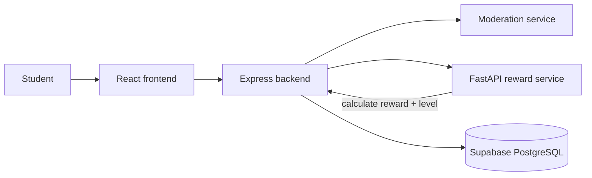

# EduBuz Reward & Gamification Documentation

Status: source-based documentation derived from the current repository snapshot. This document reflects the checked-in implementation in the Express backend, the FastAPI reward service, and related Supabase migrations; it does not claim live production behavior or live database state.

## 1. Objective

EduBuz gives students XP and progression rewards for safe learning interactions, while keeping the final state authoritative in Supabase. The reward logic is intentionally split:

- The frontend shows progress and rewards.
- The Express backend orchestrates the conversation flow and persists the result.
- The Python FastAPI service calculates reward deltas and level metadata.
- Supabase stores the canonical XP totals and reward events.

This separation is meant to keep reward calculation stateless and predictable, while ensuring the backend still owns the final write.

## 2. Runtime architecture



### Components

- Frontend: React + Vite UI for student chat, avatar shop, level display, and simple reward summaries.
- Backend: Express + TypeScript service that verifies auth, calls moderation, invokes the reward service, and writes the final gamification result.
- Reward API: Python FastAPI service in `reward-gamification-api/reward_api.py`.
- Database: Supabase tables such as `student_gamification`, `gamification_events`, and profile metadata.

## 3. Reward flow

The typical flow is:

1. Student sends a chat message.
2. Backend validates that the conversation is tied to a valid student and request.
3. Moderation checks the input and output.
4. If the output is safe, the backend calls the reward API.
5. The reward API computes the delta and level result.
6. The backend persists the outcome through a Supabase RPC or write path.
7. The frontend reads the updated XP/level from the database or a derived API response.

The implemented reward logic is fail-closed: unsafe or toxic output should not grant XP.

## 4. Reward event model

The reward service declares the supported events in `reward-gamification-api/reward_api.py`:

- `conversation_completed` = 1 XP
- `helpful_feedback` = 2 XP if the feedback is `helpful`
- `challenge_completed` = 20 XP
- `learning_milestone` = 50 XP
- `safe_interaction` = 1 XP

The service also accepts a moderation label and optional feedback. The calculation is intentionally conservative:

- `moderation_label == "TOXIC"` => reward_delta = 0 and `safety_gate = "BLOCK_REWARD"`
- `helpful_feedback` with `feedback == "helpful"` => +2 XP
- `helpful_feedback` with `feedback != "helpful"` => 0 XP

## 5. Level model

The Python service uses fixed thresholds:

| Minimum XP | Level | Name |
| --- | ---: | --- |
| 0 | 1 | Learning Explorer |
| 100 | 2 | Curious Learner |
| 250 | 3 | Active Learner |
| 500 | 4 | Problem Solver |
| 1000 | 5 | Learning Champion |

The same thresholds are mirrored in the TypeScript side (`describeLevel`) so the frontend and backend show consistent progression metadata.

The returned payload includes:

- `level`
- `name`
- `current_xp`
- `next_level_xp`
- `progress_to_next_level`

The `progress_to_next_level` value is a fraction in the range 0..1; if the student is already at the cap, the value is 1.0.

## 6. Badge model

The FastAPI service also calculates badge unlocks from input summary statistics. The known badge definitions are:

- `first_conversation` — require `conversation_count >= 1`
- `feedback_helper` — require `helpful_feedback_count >= 5`
- `challenge_solver` — require `challenge_count >= 1`
- `learning_streak` — require `streak_days >= 3`

The badges are returned as a list of objects containing:

- `badge_id`
- `name`
- `description`
- `condition`

Badge computation is stateless and only derives an output from the supplied statistics; it is not the source of truth for award persistence unless the backend explicitly writes that result to a database record.

## 7. API contract

The reward API exposes the following endpoints.

### GET /health

Returns liveness for the service.

Example response:

```json
{
  "status": "ok",
  "service": "reward-gamification",
  "stateless": true,
  "port": 8002
}
```

### POST /reward/evaluate

Request model:

```json
{
  "event": "conversation_completed",
  "current_xp": 0,
  "moderation_label": "NON_TOXIC",
  "feedback": "helpful",
  "request_id": "abc-123"
}
```

Supported event values:

- `conversation_completed`
- `helpful_feedback`
- `challenge_completed`
- `learning_milestone`
- `safe_interaction`

Response model:

```json
{
  "reward_delta": 1,
  "new_xp": 1,
  "level": {
    "level": 1,
    "name": "Learning Explorer",
    "current_xp": 1,
    "next_level_xp": 100,
    "progress_to_next_level": 0.01
  },
  "reason": "rewarded_event",
  "safety_gate": "PASS",
  "request_id": "abc-123"
}
```

### POST /reward/badges

Request model:

```json
{
  "conversation_count": 1,
  "helpful_feedback_count": 5,
  "challenge_count": 1,
  "streak_days": 3
}
```

Response model:

```json
{
  "badges": [
    { "badge_id": "first_conversation", "name": "First Step", "description": "Completed the first learning conversation.", "condition": "conversation_count >= 1" }
  ],
  "count": 1
}
```

### Auth header

If `REWARD_API_KEY` is configured, the service requires:

```http
Authorization: ******
```

The placeholder is intentionally masked here; in production this must be matched to the backend configuration value. If the key is empty, the endpoints are effectively open to the process environment; backend callers should still supply the expected key when the service is secured.

## 8. Supabase persistence layer

The backend writes the reward result to the database, with the canonical XP total stored in Supabase rather than trusting the reward service’s `new_xp` as the final value.

The core tables relevant to reward processing are:

- `profiles`
- `student_gamification`
- `gamification_events`
- related reward/notification tables created by the migration history

The TypeScript implementation uses an RPC named `credit_learning_reward` to atomically update the student’s XP and record the event.

Pseudo-flow in the backend:

```ts
await supabaseAdmin.rpc('credit_learning_reward', {
  p_user_id: studentId,
  p_request_id: requestId,
  p_event: eventType,
  p_delta: reward.reward_delta,
  p_label: moderationLabel,
  p_reason: reward.reason,
});
```

This keeps the total XP and event log server-side and avoids accepting a client-sent XP value as the source of truth.

## 9. Safety and moderation guarantees

The repository’s reward model is explicitly fail-closed:

- toxic input/output produces no reward
- blocked output does not add XP
- a reward is only granted after moderation passes
- `request_id` is used to avoid duplicate event crediting
- the reward service is stateless and does not itself hold user account data

This is important because the product is built around educational chat and student safety. Reward calculation is not independent of moderation; it is downstream of it.

## 10. Backend implementation notes

The backend-side TypeScript implementation in `backend-vite/src/services/gamificationService.ts` wraps the reward API and exposes helpers such as:

- `evaluateConversationReward`
- `getGamification`
- `persistReward`
- `processConversationReward`
- `recordFeedback`
- `checkGamificationHealth`

There are also checks for invalid student IDs, invalid request IDs, and feedback eligibility. For example, feedback can only be rewarded if the prior conversation was safe and already earned a positive reward.

## 11. Environment and deployment configuration

Relevant environment variables for reward integration include:

- `GAMIFICATION_API_URL` — the base URL for the reward service
- `GAMIFICATION_API_KEY` — the backend-side shared secret for the reward service
- `REWARD_API_KEY` — the Python process environment variable for the reward service

The service runs locally on port 8002 by default. The backend should not hardcode a localhost URL into production behavior; the runtime value should come from configuration and be verified in the deployment environment.

## 12. Security cautions

This documentation reflects the coded behavior in the repository, not a guarantee that the live migration or deployed environment already enforces the same rules. Important caveats:

- The reward service is stateless but still requires secure deployment configuration.
- The database and RLS policies must be checked separately before claiming full security guarantees.
- Reward calculation must be backed by server-side validation and DB writes; the frontend must never be treated as authoritative.
- A missing or misconfigured `GAMIFICATION_API_URL` can break reward persistence even when the UI appears to work.

## 13. Related files

- `reward-gamification-api/reward_api.py`
- `reward-gamification-api/README.md`
- `backend-vite/src/services/gamificationService.ts`
- `supabase/migrations/supabase/migrations/003_profile_gamification.sql`
- `docs/01-SYSTEM-ARCHITECTURE.md`

## 14. Summary

EduBuz’s reward system is intentionally designed as a stateless calculation service plus a server-owned persistence layer. Students earn XP only for safe, valid interactions, levels are derived from cumulative XP thresholds, and the database remains the single source of truth for both progression and event history. The backend is responsible for validating safety, calling the reward API, and writing the actual result to Supabase.
